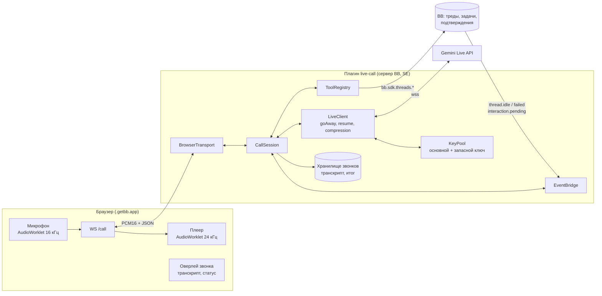
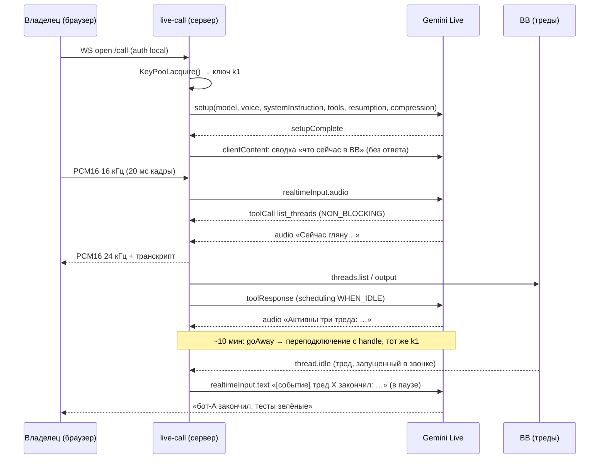
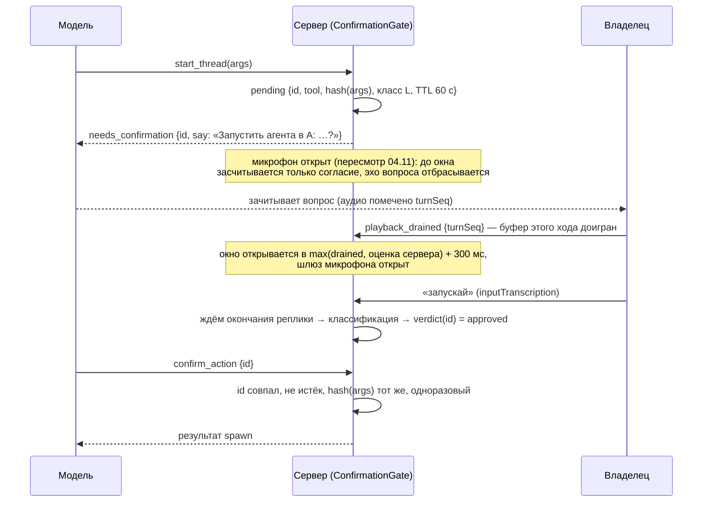

# Live Call — голосовой координатор BB на Gemini Live API

> [!NOTE]
> Архитектура и решения владельца. Точные форматы для исполнителей — в [live-call-contract.md](live-call-contract.md). Плагин реализован: `plugins/bb-plugin-live-call` (состояние — `STATUS.md` и `TODO.md` плагина, §17 ниже). Разделы 0–2.1 — исходный план 02.11; где он расходится с позднейшими решениями (Extended отключён, ADR-0006 пересмотр 2), действует решение и §13–§17.

## 0. Коротко

> [!IMPORTANT]
> Пересмотр 07.11: звонок по проекту также получает второй мозг Devin SWE-2 Flash Medium с чтением данных через коннекторы текущего звонка. Контракт — [live-call-project-brain.md](live-call-project-brain.md), основной контракт §15.9, решение — [ADR-0017](../adr/0017-live-call-project-brain.md). Формулировки ниже про одну сессию означают одну голосовую сессию; мозговой центр работает отдельно.

- **Что.** Новый плагин `live-call`. Кнопка «Позвонить» открывает живой голосовой диалог «как звонок» с агентом-координатором. Агент слышит, перебивается голосом, сам вызывает инструменты BB (треды, задачи, подтверждения) и сам докладывает, когда агенты закончили.
- **Как.** Браузер ↔ **сервер BB (плагин)** ↔ Gemini Live по WebSocket. Ключи, сессия и инструменты живут на сервере. Браузер — только микрофон и динамик. Тот же сервер позже примет звонки из Telegram, SIP и Meet: меняется только «транспорт».
- **Модель.** Голос — `gemini-3.8-live-extended-thinking`, работает в режиме **«Extended + маршрутизатор»** (§2.1). Нативные вызовы инструментов у Extended сломаны на стороне Google: 0 из 18. Поэтому решения «какой инструмент вызвать» принимает вторая Live-сессия на `gemini-3.8-live`, где вызовы работают. Сервер исполняет инструмент и вбрасывает результат в Extended, а тот докладывает голосом. Проверено вживую: 7 из 7 сценариев, ответ с данными через 1,2–2,1 с. Запасной режим — одна сессия `gemini-3.8-live` с нативными инструментами.
- **Ключи.** 1–2 ключа AI Studio в секретной настройке плагина: основной и запасной. Шлюз CLIProxy Live WebSocket **не проксирует** (404), поэтому плагин подключается к Google сам.

## 1. Что проверено вживую (02.11.2026)

| Факт | Результат | Как проверено |
|---|---|---|
| Шлюз CLIProxy проксирует Live WS | ❌ HTTP 404 | WS-рукопожатие на `/ws/…BidiGenerateContent` |
| Локальный CLIProxy (agent-proxy) умеет Gemini Live | ❌ в бинарнике нет `BidiGenerateContent` (есть только relay для OpenAI realtime) | `strings` по v7.2.140 |
| Хост BB → Google | ✅ хост BB, гео-блокировки нет | ipinfo |
| `gemini-3.8-live-extended-thinking`: голос | ✅ setup 0,65 с, первый звук 1,0–1,4 с, PCM 24 кГц | те же 12 сессий, что строкой ниже |
| `…extended-thinking`: инструменты | ❌ говорит «сейчас проверю», ставит `interactionStatus: IN_PROGRESS`, `toolCall` **не приходит**; в пробах с ожиданием 45–70 с через 13–20 с отвечает «system error» | 0 из 18: 18 сессий на разных ключах (чтобы исключить проблему конкретного ключа), в каждой объявлен инструмент `NON_BLOCKING`. Свой клиент (12 сессий): v1alpha и v1beta, LOW и MEDIUM, `parameters` и `parametersJsonSchema`, `realtimeInput.text` и `clientContent`, пример из документации один в один. Официальный SDK `@google/genai` 2.32.0 (6 сессий, HIGH): 5 раз «system error», 1 раз завис в `IN_PROGRESS`. Ещё одна проба с инструментом без параметров (ключ 13) ничего не показала: модель задала уточняющий вопрос. Чужие сообщения о том же баге: [форум Google, 28.09](https://discuss.ai.google.dev/t/gemini-3-8-live-extended-thinking-emits-no-toolcall-for-a-non-blocking-function/185649) — Google не ответил; [python-genai #3015](https://github.com/googleapis/python-genai/issues/3015) — там 39 % успеха, закрыт ботом как устаревший без исправления. Не проверено: платные ключи |
| `…extended-thinking` без `thinkingLevel` | ❌ 1007 «Thinking level must be specified» | |
| `…extended-thinking`: инструменты при вводе **голосом** | ❌ 0 из 3: фразу расслышал дословно (`inputTranscription`), сказал «сейчас посмотрю», через 3–7 с — «system error». Контроль: `gemini-3.8-live` на том же аудио вызвал инструмент. Итого по Extended — 0 из 21 | [audio-in.mjs](../../plugins/bb-plugin-live-call/research/probes/audio-in.mjs): фраза синтезирована базовой моделью, 24→16 кГц, кадры по 20 мс |
| `gemini-3.8-live`: инструменты (NON_BLOCKING) | ✅ `toolCall` на 0,98 с, ответ голосом с данными инструмента на 1,7 с | пример `searchFlights` |
| `gemini-3.8-live` с `thinkingConfig` | ❌ 1007 «Thinking level is not supported» | |
| `gemini-3.8-live` в режиме `TEXT` | ❌ 1007 «response modalities (TEXT) is not supported» | маршрутизатор работает в `AUDIO`, звук выбрасывается |
| Текстовые модели на бесплатных ключах как маршрутизатор | ❌ на бесплатном тарифе `gemini-3.5-flash-lite` — 429, `gemini-3.7-flash` — 503 «high demand» или зависание больше 40 с. Без дневного лимита — только Live-модели (у них лимит 60 тыс. токенов в минуту) | `generateContent` |
| **Связка Extended + маршрутизатор `gemini-3.8-live`** | ✅ 7 из 7 сценариев после защиты от повторов: список тредов, «ждёт меня», цепочка `list_threads` → `read_thread`, отправка в тред, болтовня без инструмента. Маршрутизатор выбирает инструмент за 0,4–1,6 с, Extended начинает доклад с данными через 1,2–2,1 с, «system error» нет | [dual.mjs](../../plugins/bb-plugin-live-call/research/probes/dual.mjs) |
| Подтверждение в режиме `router` (текстом, класс L) | ⚠️ без защиты: после «запускай» ROUTER **сам вызвал `start_thread` ещё раз** и создал второе ожидающее подтверждение; повторное «запускай» запустило бы второго агента. ✅ с защитой (пока ждёт подтверждение, реплики владельца в ROUTER не идут): одно подтверждение, одно исполнение, «да» агента не запустило, после «запускай» — доклад «агент запущен» | [dual-confirm.mjs](../../plugins/bb-plugin-live-call/research/probes/dual-confirm.mjs), `GUARD=0` и `GUARD=1` |
| Без защиты от повторов маршрутизатор зацикливается | ⚠️ 80 одинаковых `list_threads` за 24 с, когда ему возвращали пустое «done» | лечится: отдавать маршрутизатору реальный результат, дубликаты отбрасывать, ≤3 вызова на реплику |
| Возобновление сессии тем же ключом | ✅ помнит контекст («PELICAN») | `sessionResumption.handle` |
| Возобновление **другим** ключом | ❌ 1008 «session not found» | handle привязан к ключу |
| Базовая стоимость хода | ≈3,1 тыс. prompt-токенов на пустом контексте (≈2,8 тыс. — скрытый промпт модели) | `usageMetadata` |
| SDK плагинов: WS-маршрут | ✅ `bb.http.experimental_websocket` есть в SDK 0.4.87, BB 0.48.1 | `bb-plugin-sdk.d.ts` |
| SDK плагинов: управление тредами | ✅ `threads.list/get/spawn/send/output/stop`, `interactions.respond`, события `thread.idle/failed`, `interaction.pending` | backend-sdk.md |

Пробы сохранены в [research/probes/](../../plugins/bb-plugin-live-call/research/probes/). Ключ передаётся через env, в файлах ключей нет.

<details>
<summary>Ограничения Live API, которые формируют дизайн</summary>

- Соединение живёт ≈10 мин. Перед обрывом приходит `goAway` с `timeLeft`. Лечится переподключением с handle, handle живёт 2 ч.
- Без сжатия контекста аудиосессия ограничена 15 мин. Со сжатием `contextWindowCompression.slidingWindow` длительность не ограничена.
- Аудио на вход: PCM16 LE, 16 кГц, моно. На выход: PCM16 LE, 24 кГц.
- Перебивание: сервер шлёт `serverContent.interrupted`, клиент сразу сбрасывает буфер воспроизведения.
- Инструменты 3.8: только `behavior: NON_BLOCKING`. Модель говорит, пока инструмент работает. Результат приходит с `scheduling`: `INTERRUPT`, `WHEN_IDLE` или `SILENT`. У Extended Thinking `scheduling` не поддерживается.
- Конец задачи определяется по `interactionStatus: IDLE`, а не по `turnComplete`.
- Ephemeral tokens (`POST v1beta/auth_tokens`) — для прямого подключения браузера к Google. В нашей схеме не нужны.

</details>

## 2. Ключевое решение: сервер-ретранслятор (ADR-0005)



**Сетевой путь — два WebSocket-плеча:**

| Плечо | Откуда → куда | Через что | Что видит другая сторона |
|---|---|---|---|
| 1 | Браузер → сервер BB | BB Connect: `<bb>.getbb.app` → туннель → плагин на этом хосте (`/api/v1/plugins/live-call/http/call`) | Google это плечо не видит |
| 2 | Плагин → Google | Прямой `wss://generativelanguage.googleapis.com`, **не через CLIProxy**: CLIProxy Live не проксирует (404) | **IP хоста BB** |


> [!IMPORTANT]
> **Требование владельца (02.11): Google видит только IP хоста BB, никогда — IP устройства владельца.** Браузер или телефон ходит только в BB через Connect. К Google подключается только сервер плагина. Плагин не пересылает в Google ничего от клиента: ни IP, ни `X-Forwarded-For`, ни `User-Agent`, ни cookies. WebSocket к Google открывается с заголовками самого сервера. Фронтенд плагина не загружает ничего с доменов Google. По этой причине прямое подключение браузера к Google по ephemeral token запрещено, а не просто отвергнуто.

**Почему сервер, а не браузер напрямую к Google:**

1. **Ключи** не покидают сервер, ephemeral tokens не нужны.
2. **Гео.** Браузер ходит только на getbb.app. Если владелец в регионе, где Google AI недоступен, звонок всё равно работает: к Google ходит сервер в SE.
3. **Инструменты** исполняются там же, где `bb.sdk`. Нет лишнего круга «браузер → RPC → сервер».
4. **Будущие звонки** (Telegram, SIP, Meet) — это другой транспорт к тому же `CallSession`. Ядро не переписываем.
5. **Цена** — лишний сетевой прыжок через Connect: ориентировочно +50–150 мс. Измеряем в спайке Ф0.

**Отвергнуто:** браузер ↔ Google по ephemeral token. Ниже задержка, но сессия умирает с вкладкой, инструменты идут через браузер, есть гео-риск, для телефонии всё равно нужен сервер.

## 2.1. Режим «Extended + маршрутизатор» (ADR-0006)

```mermaid
flowchart LR
  A[Аудио владельца] --> V[VOICE<br/>gemini-3.8-live-extended-thinking<br/>без инструментов, ключ k1]
  A -.->|вариант Б| R
  V -->|inputTranscription<br/>реплика владельца, вариант А| R[ROUTER<br/>gemini-3.8-live<br/>нативные инструменты, ключ k2<br/>звук выбрасывается]
  R -->|toolCall| X[Сервер: ToolRegistry +<br/>ConfirmationGate]
  X -->|toolResponse с реальным результатом| R
  X -->|«[СИСТЕМА] результат …»<br/>одним пакетом| V
  V --> O[Голос владельцу]
```

- **VOICE** — Extended Thinking: разговор, рассуждение, доклады. Инструментов в `setup` нет: если их объявить, модель пытается вызвать и ломается. Системная инструкция: «действия выполняет система по словам владельца и присылает `[СИСТЕМА]`; пока ждёшь — коротко скажи, что смотришь; не выдумывай данные; не говори про системную ошибку».
- **ROUTER** — `gemini-3.8-live`, где нативные вызовы работают. Получает реплики владельца и результаты своих же вызовов. Владельцу ничего не говорит: его аудио выбрасывается. Ответы инструментов отдаём с `scheduling: SILENT`.
- **Контекст маршрутизатора.** Каждая реплика владельца уходит в ROUTER с короткой выжимкой последней реплики VOICE: `[голос сказал: «…» ≤300 символов] Владелец: …`. Так ROUTER понимает отсылки вроде «напиши ему» или «сделай, как ты предложил». Просьбой считаются только слова владельца, выжимка — контекст. Даже если ROUTER ошибётся и «исполнит» слова VOICE, запись без подтверждения владельца всё равно не пройдёт (§7.1).
- **Вход маршрутизатора.** Вариант А — текст реплики из `inputTranscription` VOICE после конца фразы: дешевле, но +0,3–0,7 с на ожидание транскрипта. Вариант Б — то же аудио в обе сессии: быстрее и не зависит от транскрипта, но вдвое больше аудиотокенов на ключе k2. Выбираем замером в Ф0.
- **Защита маршрутизатора.** Реальный результат в `toolResponse`, чтобы он мог строить цепочку. Одинаковые вызовы на одну реплику отбрасываются. Не больше 3 вызовов на реплику. Ответ на отброшенный вызов: «уже выполнено, больше не вызывай».
- **Пакетная вставка.** Результаты одной реплики копятся, пока маршрутизатор не затих на 300 мс, и уходят в VOICE **одним** сообщением `[СИСТЕМА]`. Иначе Extended начинает докладывать по первому, неполному результату (в пробе: «бот-A ещё…» до прихода `read_thread`).
- **Подтверждения в режиме `router`** (проверено в [dual-confirm.mjs](../../plugins/bb-plugin-live-call/research/probes/dual-confirm.mjs)):
  1. ROUTER вызвал инструмент записи → ConfirmationGate создаёт pending и вставляет в VOICE `[СИСТЕМА]` с готовой фразой-вопросом: «Скажи владельцу: запускаю агента в проекте A… Скажи «запускай» или «отмена»». VOICE задаёт вопрос.
  2. **Пока ждёт pending, реплики владельца в ROUTER не идут** — ни текст, ни аудио при варианте Б. Они уходят только в ConfirmationGate. Без этого ROUTER слышит «запускай» как новую команду и вызывает инструмент второй раз. Исключение — вердикт «отмена» или «неоднозначно». Тогда сервер снимает pending, отдаёт ROUTER отложенный `toolResponse` «отменено владельцем» и **пересылает ту же реплику в ROUTER как обычную**. Так «нет, сначала прочитай тред проекта A» отменяет запуск и всё равно вызывает `read_thread`. Запись по пересланной реплике снова идёт через новый pending. Вердикты `approved` и «подсказка» реплику в ROUTER не пересылают.
  3. **Шлюз микрофона (§7.1 п. 3) закрывает обе сессии**: эхо вопроса не попадает ни в VOICE, ни в ROUTER.
  4. **`toolResponse` маршрутизатору откладывается до вердикта**: вызов `NON_BLOCKING`, ответ можно прислать позже. ROUTER получает итог — «выполнено: тред thr_…» или «отменено владельцем», а при истечении TTL pending — «отменено: истёк срок подтверждения» — и знает, что произошло, для следующих реплик.
  5. При `approved` **сервер сам исполняет** действие и вставляет результат в VOICE: `confirm_action` от модели в этом режиме не нужен.
  6. Вызов с тем же `argsHash`, что у pending, новой записи не создаёт. Любой другой вызов записи, пока ждёт pending, отклоняется: «сначала ответь на текущее подтверждение».
- **Ограничение режима** (честно): **какой инструмент вызвать, решает базовая `gemini-3.8-live` по словам владельца**, а не Extended. Extended рассуждает и говорит, но запустить инструмент своим рассуждением не может. Он может только предложить: «давай я запущу агента на X?». Сделано будет, когда владелец скажет «давай» или «запускай». Опция на Ф2: разрешить ROUTER вызывать **только инструменты чтения** по фразе VOICE «сейчас посмотрю тред X». Сервер различает, откуда пришёл вызов: от реплики владельца или от выжимки VOICE. От VOICE пропускается только класс R.
- **Ключи и TPM.** VOICE и ROUTER на разных ключах: у каждого свои 60 тыс./мин. Контекст маршрутизатора маленький (реплики + короткие результаты). Раз в ~5 мин или при росте контекста маршрутизатор пересоздаётся с последними 5 репликами.
> [!IMPORTANT]
> **Отменено 03.11 (ADR-0006, пересмотр 2):** Extended отключён, переключателя режимов нет — любой звонок идёт одной сессией `gemini-3.8-live` с инструментами. Ниже — исторический текст.

- **Переключатель режимов.** Два режима для владельца, макеты — [design/live-call-mockups.html](../../plugins/bb-plugin-live-call/design/live-call-mockups.html), раздел 2:
  - **⚡ Быстрый** — одна сессия `gemini-3.8-live`, нативные инструменты (`ToolDriver = native`). Быстрее всего (~1 с), чистая документированная схема.
  - **🧠 Extended** — VOICE на Extended + ROUTER (`ToolDriver = router`). Думает глубже, ответ ~1,5–2 с. Инструмент выбирает ROUTER по словам владельца.
  - **Как переключить:** сегмент в шапке дока, голосом («переключись на Extended» — инструмент `switch_mode`, класс R), клавиша `⌘/Ctrl+Shift+K`. По умолчанию — последний выбранный режим; стартовый задаётся в настройках.
  - **Посреди звонка:** модель задаётся в `setup`, поэтому переключение = новая сессия с пересказом из `ContextLedger` (тот же механизм, что смена ключа). Пауза ~1 с, голос говорит «Переключилась». Транскрипт и карточки сохраняются, в ленте разделитель «— Extended с 04:12 —». Пока ждёт подтверждение, переключение заблокировано.
  - **Когда Google починит нативные вызовы Extended,** `bb call probe` это покажет, и режим 🧠 сможет работать одной сессией (`native`). Для владельца ничего не меняется, переключение драйвера — с его слова.

## 3. Поток звонка

Диаграмма показывает режим `native`. В режиме `router` `toolCall` приходит от второй сессии ROUTER, а результат вставляется в VOICE как `[СИСТЕМА]` (§2.1).



## 4. Компоненты сервера

| Модуль | Ответственность |
|---|---|
| `CallSession` | Одна сессия звонка: состояние (`connecting / listening / thinking / speaking / working / reconnecting / muted / ended` — как в контракте §2.2), маршрутизация аудио и событий, лимит длительности, итог в конце |
| `LiveClient` | WS к Google: `setup`, кадры аудио, `goAway` → переподключение с handle **до** обрыва, `interrupted`, `interactionStatus`, разбор `usageMetadata` |
| `KeyPool` | Основной и запасной ключ (секретная настройка), ключ закреплён за сессией. Учёт TPM по `usageMetadata` за скользящие 60 с — чтобы предупредить владельца, а не чтобы заранее менять ключ. По 429 или `RESOURCE_EXHAUSTED` — переход на запасной ключ |
| `ContextLedger` | Текстовая память звонка: транскрипты обеих сторон, вызовы и итоги инструментов. Нужна для смены ключа: handle на чужом ключе не работает, поэтому новую сессию засеваем пересказом |
| `ToolRegistry` | Объявления функций и исполнители поверх `bb.sdk`, усечение ответа (≤1,5 тыс. токенов), таймаут |
| `ToolDriver` | Кто вызывает инструменты: `router` — вторая Live-сессия `gemini-3.8-live` (§2.1), защита от повторов, пакетная вставка результатов в VOICE; `native` — инструменты в `setup` голосовой сессии |
| `ConfirmationGate` | Pending-действия классов C/P/L, шлюз микрофона на время вопроса, окно ответа по `playback_drained`, детерминированная классификация, одноразовые `confirmationId` с TTL (§7.1) |
| `EventBridge` | Подписка на `thread.idle / thread.failed / interaction.pending` по «наблюдаемым» тредам. Очередь событий; вбрасывает событие в модель только в паузе: нет речи пользователя и модель в `IDLE` |
| `Transport` (интерфейс) | `audioIn(16k PCM16)`, `audioOut(24k PCM16, turnSeq)`, `playbackDrained(turnSeq)`, `control(json)`. v1 — `BrowserTransport` на `bb.http.experimental_websocket("/call")` |
| `CallStore` | Транскрипт JSONL и итог звонка в хранилище плагина, ротация старых звонков |

**Переход на запасной ключ (handover).** Только при ошибке квоты (429 / `RESOURCE_EXHAUSTED`) или если основной ключ недоступен. Заранее, по прогнозу TPM, ключ не меняем: прогноз служит только для предупреждения «разговор упирается в лимит». Делаем это на естественной паузе: открываем сессию на k2 → `clientContent` с пересказом (сводка + последние ~10 реплик, `turnComplete: false`) → переключаем аудио → закрываем k1. Цель — разрыв ≤1,5 с. Если 429 пришёл посреди речи, модель коротко говорит «секунду, переподключаюсь» из заготовленной фразы.

**Бюджет токенов.** Каждый ход стоит весь текущий контекст (≈3 тыс. на старте). Если Google считает TPM по prompt-токенам каждого хода, 10 минут разговора упираются в 60 тыс./мин. Меры:
1. Сжатие: `contextWindowCompression: { triggerTokens: 20000, slidingWindow: { targetTokens: 10000 } }`. Числа подбираем в Ф0.
2. Ответы инструментов ≤1,5 тыс. токенов, длинное — пересказ, а не сырой вывод.
3. Запасной ключ на случай 429, при упоре в лимит — предупреждение владельцу.

## 5. Инструменты координатора

Каждый инструмент, который что-то меняет, исполняется только после подтверждения. Подтверждение проверяет **сервер** по протоколу §7.1. Ни слова модели, ни флага в аргументах для этого не хватает. Действий «выполню, если не возразил» нет.

Классы подтверждения:

| Класс | Что нужно услышать от владельца | Что точно **не** подходит |
|---|---|---|
| **R** — чтение | ничего | — |
| **C** — подтверждение | короткое согласие: «да», «давай», «подтверждаю», «отправляй», «ок» | молчание, шум, «наверное», «да, но…», согласие на другой вопрос |
| **P** — разрешение агенту | явное «разрешаю» / «разреши» / «одобряю» | просто «да» |
| **L** — запуск работы | явный глагол команды: «запускай», «запусти», «раздавай», «раздай» | «да», «давай», «согласен», «хорошо»: по правилу владельца это согласие с планом, а не запуск |

| Инструмент | Что делает | Вызов `bb.sdk` | Класс | Этап |
|---|---|---|---|---|
| `bb_overview` | Проекты, активные треды, ожидающие ответа, ошибки | `projects.list`, `threads.listRunning`, снимок ожидающих по `interaction.pending` (глобального списка в SDK нет — контракт §4) | R | Ф2 |
| `list_threads` | Треды по проекту, статусу или поиску | `threads.list / search` | R | Ф2 |
| `read_thread` | Статус и последний вывод треда, усечение ≤ 4000 символов | `threads.get / output / timeline` | R | Ф2 |
| `list_pending` | Вопросы и запросы разрешений от агентов | `threads.interactions.list` | R | Ф2 |
| `watch_thread` | Доложить, когда тред закончит | EventBridge | R | Ф3 |
| `send_to_thread` | Сообщение в существующий тред с меткой `[голос]` | `threads.send({ mode: "auto" })` | C | Ф3 |
| `answer_interaction` (вопрос агента, отказ в разрешении) | Ответ на вопрос агента; отказ в разрешении | `threads.interactions.respond` | C | Ф3 |
| `answer_interaction` (выдать разрешение) | Разрешить агенту действие | `threads.interactions.respond / resolve` | P | Ф3 |
| `stop_thread` | Остановить тред | `threads.stop` | C | Ф3 |
| `start_thread` | Новый агент: проект, пресет, промпт | `threads.spawn` | L | Ф3 |
| `tasks_create` | Создать задачу (запись, без исполнения) | `plugins.callRpc("tasks", …)` | C | Ф4 |
| `tasks_dispatch` | Раздать задачу исполнителю | `plugins.callRpc("tasks", …)` | L | Ф4 |
| `search_memory` | Память BB и KB | memory RPC / `kb search` | R | Ф4 |
| `confirm_action` | Только режим `native`: предъявить серверу `confirmationId` после ответа владельца. В режиме `router` сервер исполняет сам при `approved` (§2.1) | — | — | Ф3 |
| `end_call` | Завершить звонок с итогом | — | R | Ф1 |

> [!IMPORTANT]
> Сохраняем правила владельца. Голосовой агент — тот же координатор, просто с голосом. Правила из `~/.bb/AGENTS.md` («план ≠ команда», раздача только по прямому «запускай», без push, PR и merge) **проверяет сервер** через класс **L**: «да» никогда не запускает агента и не раздаёт задачу. Системная инструкция их только повторяет. Push, merge, деплой и удаление в v1 голосом недоступны физически: таких инструментов нет.

**Голосовой стиль** (из output-style владельца): сначала ответ, потом детали. Не больше 3–5 пунктов на реплику. Код, пути и секреты вслух не читать — говорить «прислал в чат». Числа и время конкретные.

## 6. Браузер и интерфейс

- **Захват.** `getUserMedia({ echoCancellation, noiseSuppression, autoGainControl })` → AudioWorklet → 16 кГц Int16 → бинарные кадры по 20 мс (640 байт) в WS.
- **Воспроизведение.** Кадры 24 кГц с `turnSeq` → кольцевой буфер в AudioWorklet. По `interrupted` буфер сбрасывается мгновенно, так работает перебивание. Когда доигран последний кадр хода, плеер шлёт серверу `playback_drained {turnSeq}`: от этого зависит окно подтверждения (§7.1 п. 3). Имя поля везде `turnSeq` (контракт §2.1).
- **Эхо.** На динамиках есть риск, что модель слышит сама себя и перебивает себя. Меры: AEC браузера, режим «приглушать микрофон, пока говорит агент», наушники рекомендуются. Проверяем в Ф0.
- **Макеты:** [design/live-call-mockups.html](../../plugins/bb-plugin-live-call/design/live-call-mockups.html) — десктоп-док, переключатель режима, состояния, подтверждения, события и сбои, телефон, итог звонка, настройки.
- **Точки входа.** Кнопка 📞 в шапке треда и в сайдбаре, горячая клавиша `⌘/Ctrl+Shift+L`, режим — `⌘/Ctrl+Shift+K`. Привязка по `event.code` (`KeyL`, `KeyK`): работает в русской раскладке и при фокусе в поле ввода, потому что `Mod+Shift` символов не печатает. Сверено с сочетаниями BB 0.48.1 — заняты `Mod+S`, `Mod+E`, `Mod+Shift+E`, `Mod+Shift+I`, `Mod+Shift+P`, `Mod+.`, `Mod+D`, `Mod+N`. В спеке проверить конфликты браузеров: в Firefox `Ctrl+Shift+K` открывает консоль. Сочетания можно переназначить в настройках. Звонок не привязан к треду: координатор видит весь BB.
- **Оверлей** (по образцу `speak/SpeakOverlay`): статус и индикатор уровня, живой транскрипт обеих сторон, плашки действий («отправил в тред X», ссылка), кнопки «Микрофон» и «Завершить».
- **Настройки.** Голос (по умолчанию `Algenib` — выбор владельца), язык (ru), ключи (secret, по одному на строку), максимум минут на звонок, режим эха, режим по умолчанию и уровень мышления Extended, списки слов подтверждений, горячие клавиши — полный перечень в контракте §1. Модель не настраивается: она задана ADR-0006, переключение — только с слова владельца.
- **CLI.** `bb call status | calls | transcript <id> | probe`. `probe` раз в сутки проверяет, доставляет ли Extended Thinking `toolCall`. Как только начнёт доставлять, модель можно переключить в настройках. Модель сам не меняю: правило владельца о маршрутизации.

## 7. Безопасность

- Ключи — секретная настройка плагина (файл 0600 на сервере), во фронтенд и в логи не попадают. Ключ из URL Google вырезается из текстов ошибок, как в `speak`.
- Google видит только IP хоста BB. Браузер к Google не подключается, клиентские заголовки (IP, `X-Forwarded-For`, `User-Agent`, cookies) в Google не пересылаются (§2).
- WS `/call` использует `auth: "local"` — только из доверенного origin BB. Один активный звонок на хост, второй — `409`.
- Подтверждения классов C, P и L проверяет сервер по протоколу ниже. Модель не может «сама решить», что подтверждено.
- Ответы инструментов проходят фильтр: длинное усекается, явно секретное (ключи, токены) маскируется до передачи в модель.
- Транскрипты хранятся локально в хранилище плагина. Куда отправлять итог звонка — решение владельца (§10).

### 7.1. Протокол подтверждения (`ConfirmationGate`)



1. **Pending-действие.** Инструмент класса C/P/L без подтверждения ничего не исполняет. Он создаёт запись `{confirmationId, tool, argsHash, class, say, createdAt, expiresAt = +60 с}` и возвращает `needs_confirmation` с готовой фразой. Фраза называет действие коротко; нужное слово показывает карточка (пересмотр 04.11, п. 3.1). Одновременно ждёт **одна** запись. Новая её **не заменяет**: повтор с тем же `argsHash` возвращает ту же запись, другой вызов записи отклоняется до вердикта («сначала ответь на текущее подтверждение»). Снять запись можно только отказом владельца, кнопкой «Отмена», по TTL или **завершением звонка**. `end()` по любой причине первым делом переводит шлюз в конечное состояние: pending без вердикта сгорает с вердиктом `cancelled`; в журнал **до** `endCall` пишется `verdict { tool, verdict: "cancelled", reason: "call_ended" }`; таймеры шлюза (конец реплики, перебивание, окно, ожидание `confirm_action`) снимаются; новые `request` отклоняются. После `end()` кнопка (`confirm`), реплика и таймер ничего не исполняют и в журнал не пишут; ответного кадра на `confirm` нет — браузер уже получил `ended`. Исполнение, начатое до `end()`, не прерывается, но его итог в голос не вставляется. (PLUG-120 п. 3) После вердикта запись сгорает, но её `argsHash` помнится **5 минут**: тот же вызов записи в этом окне не создаёт новый pending, а получает ответ «уже выполнено» или «отменено владельцем» — иначе вторая реплика «запускай» создала бы второй pending и второго агента.
2. **Чей голос в зачёте.** В зачёт идёт только `inputTranscription` голосового транспорта. Текст тредов, ответы инструментов и речь модели не учитываются: агент в треде не может написать «запускай» вместо владельца. Но `inputTranscription` распознаёт весь входной поток и не отличает владельца от динамика. Поэтому в вопросе нет слова подтверждения, а реплика из слов самого вопроса отбрасывается как эхо (п. 3.1).
3. **Шлюз микрофона и окно ответа.** `turnComplete` — это конец *генерации*, а не воспроизведения: Gemini отдаёт аудио быстрее реального времени, и браузер ещё секунды доигрывает буфер. Поэтому `turnComplete` окно **не открывает**.
   1. **Пересмотр 04.11 (решение владельца):** микрофон во время вопроса **открыт** — вопрос можно перебить словом согласия. Раньше шлюз был закрыт с `needs_confirmation` до конца вопроса, а вопрос дословно зачитывал всё сообщение — «да» ждали 15–20 с. Теперь:
      - вопрос вслух короткий: действие и первые 8 слов текста, без «Скажи «да» или «отмена»»; слово и полный текст — на карточке (`summary` кадра `confirmation` = полный текст);
      - до открытия окна засчитывается **только согласие** нужного класса (для L — глагол запуска). Отказ, шум и длинные фразы до окна ничего не решают, иначе эхо вопроса отменяло бы действие;
      - реплика, начавшаяся раньше 1,5 с от `needs_confirmation` (`BARGE_IN_MIN_MS`), — хвост просьбы владельца, не ответ; она отбрасывается целиком, пока не будет 700 мс тишины (ревью PLUG-113);
      - **Заменено §7.2.1–7.2.2 (09.11):** решение по перебиванию и вставка раннего «да» — по §7.2; текст ниже — история.
      - перебить можно только **звучащий у владельца** вопрос: момент начала считается по звуку — первый кадр аудио после запроса + длительность аудио до куска транскрипта, на котором в накопленном транскрипте хода модели впервые появилось **начало вопроса** или его хвост, + 0,5 с запаса (`QUESTION_HEARD_SLACK_MS`). **Начало вопроса** (пересмотр 05.11 по голосовой приёмке PLUG-119 и ревью спеки Opus: прежнее правило «название объекта без слов аргументов» давало пустой набор у всех вопросов, где объект — сам аргумент, и вопрос считался услышанным только на последних словах). Кавычка здесь — только `«` (её ставят `quoteArg`/`quoteBrief`). **Слова шаблона** — слова say до первой `«`; **слова объекта** — первые два слова внутри этой пары `«…»` (одно, если там одно слово; первая `«` может открывать название треда, проекта или задачи — тогда объект берётся из названия). Начало найдено, когда в транскрипте хода модели слова шаблона идут по порядку, между соседними — не больше одного вставленного слова («Отправить **сообщение** в тред»), и **сразу** после последнего слова шаблона подряд идут слова объекта. Филлер начала не содержит: после шаблона в нём не идут слова объекта. Нормализация — токены §7.1 п. 9.1 шаг 1 (склейка дефисов, апостроф между буквами) для say и транскрипта модели; в ответах владельца дефис разделяет слова (п. 5: «Да-да» → «да да»). Транскрипт хода — только текст, пришедший после `needs_confirmation` и после последнего сброса оценки вопроса (раннее «да», подсказка L/P, повтор вопроса); филлер до вызова в том же ходе и текст прерванного вопроса не в счёт. **Хвост вопроса** — последние два слова say-фразы подряд; запасное правило, засчитывается, только если в хвосте есть слово из `«…»`. Если в say нет `«` (`stop_all`, «Одобрить запрос агента?», ручки коннектора `ключ=значение`, запасные фразы) — начала и хвоста нет, `question_heard` не наступает, согласие засчитывается только в окне: у ручек коннектора перебивания нет; согласие до окна при этом не замалчивается — та же вставка «это не подтверждение», что при раннем «да». **Момент реплики владельца** определяется по звуку: начало речевой активности микрофона перед первым куском (VAD уже требуется в п. 4). Если его нет — время первого куска минус `INPUT_TRANSCRIPT_LAG_MS` = 2 с (≈ измеренная задержка 1,8–2,1 с; остаток покрывает запас `QUESTION_HEARD_SLACK_MS` 0,5 с; при эхе VAD-онсет выходит раньше настоящего — безопасная сторона). Момент реплики нужен только для согласия: в перебивании согласие засчитывается, если момент ≥ `question_heard`. Деление на перебивание и окно — по первому куску (п. 3.5), не по моменту: окно открывается через ≈1–1,3 с после конца звука, и быстрое «нет» сразу после вопроса иначе попало бы в перебивание, где отказ не засчитывается. Момент пишется в журнал. По тексту нельзя: транскрипт обгоняет звук. Название из транскрипта надёжно выделить нельзя (обрывки, пересказ) — тогда согласие засчитывается только в окне ответа, по оценке сервера. «Да» во время филлера («Секунду, передаю…») или до названия объекта не засчитывается — владелец ещё не слышал, что именно подтверждает (§16.3; приёмка PLUG-114). Отброшенное согласие сервер не замалчивает: он сразу прерывает модель и вставляет `[СИСТЕМА] Владелец сказал «да» до вопроса — это не подтверждение, ничего не выполнено. Задай вопрос подтверждения коротко и дождись ответа` — иначе модель слышит «да» во входном аудио, пропускает вопрос и докладывает об исполнении, которого не было, а `question_heard` не наступает никогда (приёмка PLUG-116). Детали вставки: решение — по **завершённой** реплике (правила окончания п. 4), не по первому куску — «да» может оказаться началом «да, но сначала…»; на один вопрос вставляется не больше одной такой реплики, повторные куски и опоздавший хвост отброшенной реплики новых вставок не создают. Повторный вопрос не создаёт новый pending: `confirmationId`, `argsHash`, объект действия и исходный TTL сохраняются; сервер пересчитывает оценку длительности аудио и игнорирует запоздалые сигналы воспроизведения прерванного вопроса (в том числе его `playback_drained`);
      - эхо: если все слова реплики есть в тексте вопроса, карточки или в речи модели за 15 с до запроса и после него (в том числе однокоренные: первые 6 букв) — реплика отбрасывается;
      - подсказка класса L/P («Для запуска скажи «запускай»») содержит слово подтверждения, поэтому пока она звучит, шлюз закрыт, как раньше.
   2. Сервер помечает `turnSeq` каждый ход модели после `needs_confirmation` и считает длительность аудио по байтам (48 000 байт = 1 с при 24 кГц PCM16). Модель может разбить речь на филлер и вопрос, поэтому окно ждёт **последний** из этих ходов: модель молчит не меньше 300 мс и нового аудио нет.
   3. Плеер в браузере шлёт `playback_drained {turnSeq}`, когда доиграл последний кадр хода.
   4. Окно открывается в `max(playback_drained последнего хода, t_первого_кадра + суммарная длительность + 1 с) + 300 мс`. Оценка сервера страхует от потерянного или слишком раннего сообщения клиента. Шлюз открывается в тот же момент.
   5. Гейтинг длится столько же, сколько звучит вопрос, — секунды. В зачёт идут только реплики, **начавшиеся** после открытия окна: сервер помечает временем каждый кусок транскрипта, реплика с первым куском до открытия окна отбрасывается целиком, её опоздавший хвост не склеивается с новыми репликами. Так лаг распознавания не превращает речь до вопроса в вердикт.
   6. Перебить вопрос голосом «нет» нельзя: отказ до окна не засчитывается, но и ничего не исполнится. Отмена во время вопроса — кнопкой «Отмена» в оверлее или словом «нет» после. Согласие — голосом в любой момент вопроса (п. 3.1).
   7. Будущие транспорты (SIP, Telegram) обязаны давать тот же сигнал `playbackDrained(turnSeq)`. Без него окно открывается только по оценке сервера с запасом 1,5 с.
4. **Задержка транскрипта.** Транскрипт входа приходит кусками и с опозданием. Реплика считается законченной, когда 700 мс нет новых кусков и закончилась речевая активность (VAD). Если `confirm_action` пришёл раньше, сервер ждёт окончания реплики до 3 с. Не дождался — `not_confirmed`, модель переспрашивает.
5. **Классификация — детерминированная, на сервере.** Нормализация: нижний регистр, ё→е, без пунктуации, разбиение на слова. Сравниваем целые слова, а не подстроки. Реплика в окне ответа сначала проходит **эхо-фильтр**: если все слова реплики (корни по 6 букв для всех слов, в том числе слов ответа: распознавание превращает эхо глагола вопроса в другую форму — «отправь» из «Отправить», «запусти» из «Запустить», и без корней такое эхо стало бы согласием; поэтому say класса P не содержит корня «разреш» — вопрос «Одобрить запрос агента в «X»?», а «разрешаю» в ответ эхом не считается) есть в тексте вопроса или карточки из последних 15 с, реплика **не решает ничего** — ни approved, ни cancelled; pending живёт до вердикта владельца, кнопки или TTL. Иначе первый кусок эха вопроса в окне («отправ» от «отправить») сжигал бы подтверждение как «отмена», и «отмена», сказанная владельцем позже, уходила в пустоту (приёмка PLUG-116). В окне эхо-набор — только вопрос и карточка. Подсказка класса L/P («Для запуска скажи «запускай»») не попадает в эхо-набор: пока она звучит, шлюз закрыт и окно переоткрывается (п. 3), поэтому сказанное после неё «запускай» засчитывается. Слова из свободной речи модели в эхо-набор не включаются: по одному слову сервер не отличит владельца от динамика, но такие слова редки, а надёжные пути — кнопки «Подтвердить»/«Отмена» — работают при любом раскладе. Если слово согласия или отказа вошло в вопрос через текст самого действия (например, отправить сообщение «нет»), голое «нет» может быть проглочено фильтром — тогда владелец отменяет кнопкой или развёрнутой фразой («нет, отмена»). До окна фильтр шире — слова и речи модели (п. 3.1): там лишняя отброшенная реплика ничего не решает, а в окне решение принимается, поэтому набор уже. Порядок классификации после эхо-фильтра:
   1. Есть слово-отказ или «стоп-слово» (`нет`, `не`, `отмена`, `отмени`, `отменяй`, `отменить`, `отменяю`, `отбой`, `стоп`, `стой`, `подожди`, `погоди`, `потом`, `но`, `отставить`, `отставь`, `отказ`, `отказываюсь`, `нельзя`, `неа`, `нее`, `хватит`, `передумал`, `передумала`) → **отмена**. Латинские написания (распознавание иногда пишет русскую речь латиницей) нормализуются заранее; отказы латиницей: `net`, `nyet`, `niet`, `njet`, `no`, `nope`, `otmena`, `otmeni`, `cancel`, `stop`, `stoi`.
   2. **Шум** (ревью спеки Opus 05.11): нет ни слова из списков согласия C, P, L, ни отказа, а после удаления слов эхо-набора остаётся ровно одно слово любым письмом (пустая реплика — молча, без вставки и без счёта) (на голосовой приёмке PLUG-119 эхо динамика давало «at», «A», «Прошу») → **вердикта нет**. Сервер прерывает модель и вставляет `[СИСТЕМА] Ответ владельца не распознан: ничего не выполнено и не отменено. Повтори вопрос подтверждения одной фразой и жди «да» или «нет»`; шлюз закрыт с момента вставки до нового окна, окно открывается заново (новое поколение; правило п. 5.4 (а) применяется, свидетельство новой речи (б) не нужно — в повторе нет слова согласия; если аудио повтора не пришло за 3 с, окно открывается по резервному таймеру с отступом 300 мс, как у подсказки). Не больше одной такой вставки на pending; второе нераспознанное одиночное слово → **отмена**. Так «ок» после «Понял, не отправляю» не исполняет действие: засчитывается только ответ после повторного вопроса.
   3. Неоднозначно → **отмена**. Это когда реплика длиннее 6 слов или после удаления разрешённых слов остаётся что-то ещё. Пример: «да, сначала проект A». Разрешённые слова: слова нужного класса, вежливые (`ну`, `пожалуйста`, `конечно`, `уже`), а для классов L и P — ещё слова класса C как довесок к глаголу. Так «да, запускай», «давай, раздай» и «да, разрешаю» проходят, а одно «да» для L и P — нет (подпункты 4–5 ниже). Остаток — любым письмом, после удаления слов эхо-набора («отправ да» → approved; «да, сначала в другой тред» → отмена). Для остатка эхо-набор — **только вопрос и карточка**, и в окне, и при перебивании до окна: широкий набор перебивания (с речью модели за 15 с, п. 3.1) решает лишь, не эхо ли вся реплика; иначе «да» с уточнением из слов филлера модели («да, по поводу моделей») засчитывалось бы. Так «Да, отправь.» во время вопроса «Отправить в тред: «…»?» — согласие («отправь» однокоренное с «Отправить», живой звонок 05.11 терял эту реплику при перебивании).
   4. Класс **L**: есть глагол из списка запуска (`запускай`, `запусти`, `запускаем`, `раздавай`, `раздай`) → approved. Только слова класса C («да», «давай») → **не запуск**: запись остаётся ждать до TTL. Подсказка — только если в реплике есть слово класса C; реплика из одних вежливых слов — **отмена** (п. 7). При подсказке сервер прерывает текущий ход модели и вставляет в голосовую сессию (одинаково в `native` и `router`) `[СИСТЕМА] «Да» для этого действия не подходит, ничего не выполнено. Скажи владельцу одной фразой: «Для запуска скажи «запускай»» и жди ответа` (для P: `…«Чтобы разрешить, скажи «разрешаю»»…`). Старая say-фраза не повторяется. `confirmationId`, `argsHash` и исходный TTL не меняются. Аудио и `playback_drained` ходов до подсказки не учитываются (новое поколение окна, как при раннем «да», п. 3.1). Окно открывается по п. 3.2–3.4 по ходу с подсказкой. Если аудио подсказки не пришло за **3 с**, окно открывается через 3 с с отступом 300 мс (п. 3.4) — оценки без аудио нет, поэтому это отдельный таймер, а не `tick()`; микрофон не остаётся закрытым до TTL. Пока звучит подсказка, шлюз микрофона снова закрыт. То же для класса P со словом «разрешаю». (PLUG-120 п. 7) Слова подсказки в эхо-набор окна **не** входят: «запускай» в подсказке и в ответе владельца — одно и то же слово, по словам их не различить. Защита от эха подсказки и от запоздалого распознавания (ревью PLUG-120 round-2: Google доставляет `inputTranscription` независимо от порядка аудио, поэтому время прихода текста не доказывает, что он про новое аудио): (а) Пока pending не получил вердикт, каждый ненулевой PCM-кадр активного поколения подсказки, включая кадры после резервного открытия, закрывает шлюз и инвалидирует это окно. Снимаются таймер окна и незавершённая реплика/таймер классификации, привязанные к инвалидированному окну; сбрасывается его свидетельство новой речи. Байты аудио подсказки продолжают накапливаться для оценки по п. 3.2–3.4. Устаревшие таймеры и сигналы другого поколения окно не открывают. Новое окно открывается по п. 3.2–3.4; `confirmationId`, `argsHash` и исходный TTL сохраняются. Нулевой кадр `LiveClient` — маркер конца хода, не звучащее аудио. (б) **Свидетельство новой речи — эвристика, не доказательство происхождения.** Реплика в окне после подсказки решается по её **окончании** (п. 4); первый кусок не уничтожает реплику из-за ещё не накопленного свидетельства. `approved` — только если между открытием этого окна и окончанием реплики набралось свидетельство новой речи. Учитывается только валидный PCM текущего окна, фактически переданный в текущую голосовую сессию; амплитуда для него берётся до серверного приглушения ×0,25. Кадры muted, закрытого шлюза, неверного размера и без отправки в сессию не учитываются. Полученный PCM разбивается для этой проверки на последовательные блоки по 320 сэмплов (20 мс при 16 кГц), независимо от границ WebSocket-пакетов. Для каждого полного блока вычисляется max(abs(sample)) исходного PCM16. В сумму входят 20 мс за блок с peak > `HINT_SPEECH_PEAK` = 300. Свидетельство достаточно при сумме ≥ `HINT_SPEECH_MIN_MS` = 150 мс (то есть минимум 8 полных блоков, 160 мс). Неполный блок накапливается; остаток и счётчик сбрасываются при инвалидировании/смене окна. Свидетельство ограничивает `approved`; отсутствие свидетельства в этой ветке оставляет pending без вердикта. Обработка явного отказа после окна остаётся по п. 5.1; отказ до окна и разрешённый barge-in — по п. 3.1. Остаточный риск принят (решение куратора 05.11, ревью PLUG-120 round-2): Gemini не даёт проверенной привязки `inputTranscription` к исходному аудиосегменту, а время прихода текста её не доказывает, поэтому эвристика не доказывает, что распознанное слово произнёс владелец. Примеры остаточного риска — задержанный транскрипт прежнего входа после посторонней новой речи и эхо, снятое уже после открытия окна. Тихий или очень короткий ответ эвристика может не принять — тогда кнопка. Тот же класс риска (запоздалый текст) в основном окне ответа не закрывается: там согласие до окна разрешено (п. 3.1), а отказ до окна не засчитывается. Надёжный путь в обоих случаях — кнопки «Подтвердить»/«Отмена».
   5. Класс **P**: `разрешаю`, `разреши`, `одобряю` → approved.
   6. Класс **C**: `да`, `давай`, `подтверждаю`, `отправляй`, `ок`, `окей`, `верно`, для `stop_thread` ещё `останавливай` → approved.
   7. Всё остальное (два и больше слов без согласия и отказа, в том числе вежливые) → **отмена**.

   Списки слов хранятся в настройках: владелец может их расширить, но не сделать пустыми.
6. **Привязка и одноразовость.** Вердикт привязан к `confirmationId`. `confirm_action` исполняет действие, только если id существует и не истёк, вердикт `approved`, `argsHash` совпадает с вопросом (модель не может подменить аргументы после «да») и id не использован. После исполнения или отмены id сгорает.
7. **Кнопка в оверлее.** Пока ждёт pending-действие, оверлей показывает его текст и кнопки «Подтвердить» / «Отмена», привязанные к тому же id. Нажатие равно approved для классов C, P и L: это явное действие владельца. Исполняет кнопка **сервер, немедленно и в обоих режимах**: в `native` модель узнаёт результат через `toolResponse`, в `router` — через вставку `[СИСТЕМА]`. Удобно в шуме или когда распознавание сбоит.
8. **Журнал.** Каждое pending-действие, реплика, вердикт и исполнение пишутся в транскрипт звонка: потом видно, кто и что подтвердил. У события `verdict` пишется путь принятия `via: "barge" | "window" | "button" | "system"` и момент реплики владельца (п. 3.1): приёмка перебивания — `via = "barge"`, а не сравнение времени вердикта с открытием окна (вердикт выносится через ≥700 мс тишины после последнего куска, а кусок приходит через 1,8–2,1 с после речи — ревью спеки Opus 05.11).
9. **Ложный доклад об исполнении (`false_claim`).** Пока pending ждёт вердикта, сервер проверяет **итоговый текст завершившегося хода** модели (полный `outputTranscript` хода, включая слово, разрезанное между кусками). Доклад — целое слово после нормализации из списка `отправлено`, `отправлен`, `отправлена`, `отправил`, `отправила`, `передано`, `передан`, `передала`, `готово`, `выполнено`, `выполнена`, `выполнил`, `выполнила`, `сделано`, `сделал`, `сделала`, `создано`, `создана`, `создал`, `создала`, `запущено`, `запустил`, `запустила`; корневого схлопывания нет. `создан` в списке нет (сводки: «этот тред создан для…»); `готово`, за которым идёт «к» или «для» («готово к отправке»), — не доклад. Сервер сначала вычищает из текста хода известные фрагменты — say-фразу текущего вопроса и текст карточки (текст самого действия, который модель зачитывает или цитирует), — и ищет доклады только в **оставшейся речи**: зачитанный вопрос и цитируемый текст действия докладом не считаются, но «[вопрос]. Уже отправлено» и «Сообщение отправлено в тред» при отправке текста «отправлено» докладом остаются (ревью дельты codex: исключение действует на фрагмент, не на весь ход). Слово с предшествующим «не» — не доклад. При сработавшем правиле сервер прерывает модель и вставляет `[СИСТЕМА] Действие ещё не подтверждено и не выполнено. Задай вопрос подтверждения и дождись вердикта`, в журнал пишется событие `false_claim` (п. 8); на один pending — не больше одной такой вставки. После вердикта и исполнения те же слова — обычная речь. Повод: на приёмке PLUG-116 модель пропустила вопрос после раннего «да» и сказала «Сообщение отправлено в тред», ничего не отправив.

   **9.1. Алгоритм вычистки (детерминированный, ревью PLUG-119 round-5).** Эвристики «где закрыть незакрытую кавычку» не используются: кавычки модель в транскрипте ставит произвольно, граница цитаты определяется совпадением с текстом действия, а не знаком препинания.

   1. **Токены.** Текст хода, say и карточка режутся на слова: последовательности букв и цифр в нижнем регистре, `ё`→`е`; апостроф (`'` или `’`) **между буквами** — часть слова (`o'reilly` — одно слово); дефис **между буквами или цифрами** (`-`, `‐`, `‑`) удаляется, части склеиваются: `агенту-куратору` → `агентукуратору`, `из-за` → `изза` — транскрипт речи модели дефисы теряет (звонки 04.11); склейка одинакова для хода, say и текста действия. Вся прочая пунктуация (`.,:;!?…`, `...`, `?!`, тире, кавычки) — разделитель и в сравнении не участвует. Позиции слов хода сохраняются: исключённые слова **помечаются**, а не удаляются, чтобы соседство («не» + слово) не возникало искусственно.
   2. **Текст действия** — источники: (а) **полный текст действия** — значение аргумента `text`/`answer`/`task`/`body`, которое карточка показывает целиком (это не вся строка карточки: при длинном тексте карточка = say + `«полный текст»`, при коротком = say); (б) Источники перечисляет тот же formatter, который вставляет аргументы в цитируемые блоки say, после resolve аргументов. Для каждой такой вставки сохраняется полное исходное строковое значение использованного аргумента. Кавычки внутри значения — данные и не меняют происхождение/границы вставки. Если formatter действительно применил brief или другое предусмотренное для этого поля усечение и оставил непустое начало, источником остаётся полное исходное значение; факт усечения фиксируется при формировании say. Совпадение значения или префикса другого аргумента с текстом блока само по себе не делает другой аргумент источником. Восстановление источников разбором готового say не применяется. (в) у **ручки коннектора** источники перечисляет formatter её say (ключ=значение, ограничения 50 символов на значение и 200 на список): источник — полное исходное строковое значение каждого поля любой вложенности (для вложенных — строковые листья), которое представлено в **окончательном** say целиком либо разрешённым непустым усечением; поля, целиком выпавшие из окончательного say по общему ограничению, источниками не являются; вложенность сама по себе не исключает. Представленность поля определяется **происхождением**: formatter при сериализации запоминает, какой отрезок say занимает каждый строковый лист (с учётом JSON-экранирования), и после обоих ограничений считает лист представленным, если в видимой части say целиком видна запись хотя бы одного **исходного символа значения**, который является буквой или цифрой (буквы escape-последовательностей `\n`, `\t`, `\uXXXX` и половина суррогатной пары символами значения не считаются; обрыв посреди escape-последовательности — символ не виден); совпадение подстрок или префиксов с другим местом say представленность не доказывает. Для ручек коннектора применяется только (в); (а) и (б) относятся к встроенным инструментам. Объявление путей в реестре не вводится: озвученное поле владелец слышит, неозвученное — не источник. Пусто — шаг 4 пропускается. Источники собираются при создании pending тем же кодом, что строит say, и передаются в проверку явно; строка карточки целиком, совпадение префиксов и разбор готового say источниками не служат.
   3. **Полные фрагменты.** Помечаются все вхождения полной последовательности слов say и все вхождения полной последовательности каждого источника текста действия длиной **от 2 слов** — независимо от кавычек вокруг.
   4. **Цитаты.** Открывающая кавычка — `«`, либо `"`, `'`, `“`, `„`, перед которой не буква и не цифра, а сразу за ней — буква или цифра. После каждой открывающей кавычки помечается **максимальная** цепочка слов хода, целиком совпадающая с непрерывным отрезком **одного** источника текста действия (любой длины от 1 слова). Цепочка обрывается на первом несовпадающем слове — дальше уже обычная речь, даже если кавычка не закрыта. Закрывающие кавычки и пунктуация на это не влияют.
   5. **Доклад.** `false_claim`, если в ходе есть непомеченное слово из списка докладов, перед которым в исходной последовательности слов хода не стоит **непомеченное** (не входящее в исключённый фрагмент шагов 3–4): «не»; «будет», «будут» или «бы» (обещание или условие, а не доклад); «не» и следом одно из «было», «будет», «будут», «бы» («ещё не было отправлено», «ничего не будет сделано»). «Было отправлено» без «не» — доклад. Подавляющая конструкция учитывается только если **каждое** входящее в неё слово непомечено: одиночное «не»; одиночное «будет»/«будут»/«бы»; оба слова пары «не» + «было»/«будет»/«будут»/«бы». Соседство проверяется в исходной последовательности слов хода, без удаления помеченных слов. `готово` перед «к»/«для» — не доклад.

   Без кавычек одиночное слово действия (текст «отправлено») не исключается — «Сообщение отправлено в тред» остаётся докладом. Обратное ограничение: если модель произнесёт **весь** текст действия длиной от 2 слов без кавычек как доклад («Письмо отправлено» при тексте действия «Письмо отправлено»), это считается цитатой — ложного прерывания правильного вопроса это не стоит. Ограничение полного совпадения относится к любому источнику (а)–(в), включая озвученные служебные строки коннектора (`successMessage=Сообщение отправлено`): если весь самостоятельный доклад совпал с таким источником длиной от двух слов, он считается цитатой. Это ограничение обнаружения `false_claim`, а не подтверждения: действие без вердикта не исполняется.

   Контрольные случаи (say = `Отправить в тред: «Готово, письмо отправлено»?`, карточка = `Готово, письмо отправлено`, если не указано иное):

   | Ход модели | false_claim |
   |---|---|
   | `Отправить в тред: «Готово, письмо отправлено»?` | нет |
   | `… «Готово, письмо отправлено»? Текст сообщения: «Готово, письмо отправлено».` | нет |
   | `… «Готово, письмо отправлено»? Уже отправлено.` | да |
   | `Отправить в тред: «Готово, письмо отправлено? Уже отправлено.` (кавычка не закрыта) | да |
   | `Текст сообщения: Готово, письмо «отправлено».` | нет |
   | `Отправить сообщение в тред: «Готово… письмо отправлено?` (say/карточка с `…`/`?!` внутри) | нет |
   | `Для O'Reilly уже отправлено.` | да |
   | say/карточка `«Для O'Reilly готово»`, ход `Отправить сообщение в тред: «Для O'Reilly готово»?` | нет |
   | say/карточка `«Проверка»`, ход `Отправить в этот тред: «Проверка, уже отправлено.` | да |
   | say/карточка `«отправлено»`, ход `Отправить в тред «отправлено»? Сообщение отправлено в тред.` | да |
   | `Не отправлено, жду ответа.` | нет |
   | `Простите, сообщение ещё не было отправлено. Отправить в тред: «Готово, письмо отправлено»?` | нет |
   | `Сообщение будет отправлено после подтверждения. Отправить в тред: «Готово, письмо отправлено»?` | нет |
   | `Сообщение было отправлено в тред.` | да |
   | `Сообщение готово к отправке. Отправить в тред: «Готово, письмо отправлено»?` | нет |
   | `Ваш ответ отправлен агенту.` | да |
   | say/текст `«Передай агенту-куратору: всё сделано»`, ход `Отправить в тред: «Передай агентукуратору: всё сделано»?` | нет |
   | текст действия длиннее 8 слов со словом доклада после 8-го, ход читает его целиком без кавычек и спрашивает «Отправить?» | нет |
   | say/текст `«Письмо отправлено»`, ход `Письмо отправлено.` (принятое ограничение, см. выше) | нет |
   | `tasks_create`, args `{title: "Проверка", spec: "Сообщение отправлено"}`, say `Создать задачу «Проверка»?`, ход `Сообщение отправлено.` (`spec` не источник) | да |
   | say/текст `«не»`, ход `Отправить в тред: «не»? Отправлено.` («не» помечено) | да |
   | ход `1'отправлено` (апостроф после цифры — разделитель) | да |
   | `tasks_create`, args `{title: "Проверка", spec: "Проверка выполнено"}`, say `Создать задачу «Проверка»?`, ход `Проверка выполнено.` (совпадение префикса — не источник) | да |
   | `tasks_create`, title `"отправлено" клиенту`, say `Создать задачу «"отправлено" клиенту»?`, ход `Создать новую задачу «отправлено клиенту»?` (кавычки внутри значения — данные) | нет |
   | коннектор, args `{first…fourth: по 80 символов, auditNote: "Сообщение отправлено"}`, auditNote выпал из say по пределу 200, ход `Сообщение отправлено.` | да |
   | коннектор, args `{payload: {text: "Готово, письмо отправлено"}}`, say `…payload={"text":"Готово, письмо отправлено"}?`, ход `Установить payload: «Готово, письмо отправлено»?` | нет |
   | коннектор, args `{successMessage: "Сообщение отправлено"}`, ход `Сообщение отправлено.` (принятое ограничение) | нет |
   | коннектор, `payload {preview: "Проверка завершения", pad: 80×x, audit: "Проверка завершения выполнено"}`, audit не попал в say, ход `Проверка завершения выполнено.` | да |
   | коннектор, `payload {pad: 26×x, text: "Готово, письмо отправлено"}`, в say видно только `Готов…`, ход `Установить payload: «Готово, письмо отправлено»?` | нет |
   | коннектор, `payload.text` = «Сообщение», **перевод строки** (символ U+000A), «отправлено»; в say он показан JSON-экранированием — обратная косая и буква n, ход `Установить payload: «Сообщение отправлено»?` | нет |
   | коннектор, `payload {pad: 24×x, text: четыре перевода строки + «Сообщение отправлено»}`, в say от text видно только экранирование переводов строки, ход `Сообщение отправлено.` | да |


### 7.2. Пересмотр 09.11: быстрое «да», вопрос подтверждения, мозговой центр (ADR-0020)

Основание — звонок владельца 09.11 00:34–00:40 UTC. Владелец сказал «да» четыре раза, засчиталось третье. Модель 70 с молчала после «секунду, уточню». Требование владельца: **«да» засчитывается, как только вопрос начал звучать; ждать, пока модель договорит длинную фразу, владелец не будет.** Раздел дополняет §7.1 и при расхождении главнее его.

**7.2.1. Голосовое «да» на перебивании — по звуку, который владелец реально услышал (решение владельца 09.11, упрощение).**
- История: попытки определить, где внутри хода модели начался текст вопроса (по транскрипту Gemini), дали шесть кругов ревью и каждый раз новый путь ложного или мёртвого «да»: транскрипт приходит не синхронно со звуком, звук — примерно ×7 быстрее реального времени, якорные слова встречаются в фразе ожидания. Владелец 09.11 выбрал упрощение: **место вопроса внутри хода для решения не определяется**.
- **Правило.** При pending «да» (классификация §7.1, эхо-фильтр, слово класса L/P) засчитывается перебиванием (`via barge`), если начало реплики владельца пришлось на момент, когда браузер **уже проиграл звук модели, полученный после запроса подтверждения**:
  - браузер шлёт `speech_start { turnSeq, playedMs }` (детектор речи по уровню микрофона: ≥120 мс над порогом, повтор после 400 мс тишины; `playedMs` — реально проигранный звук хода `turnSeq` от его начала, через все буферы хода);
  - сервер при создании pending запоминает `requestTurnSeq` (ход, открытый в этот момент, или последний выданный) и `requestTurnBytes` — сколько байт звука этого хода уже было получено к запросу (`requestTurnMs` по 24 кГц);
  - «да» после звука ответа, если `turnSeq > requestTurnSeq` и `playedMs > 0`, или `turnSeq == requestTurnSeq` и `playedMs > requestTurnMs`; иначе — раннее;
  - реплика, начатая раньше `BARGE_IN_MIN_MS` (1,5 с) от запроса, — хвост просьбы владельца, отбрасывается (`result: "tail"`). Момент начала — по приходу кадра `speech_start`; без кадра — оценка `firstChunkAt − 2 с`. Оценка здесь допустима: она только отбрасывает реплику и никогда не засчитывает согласие.
  - Нет открытого хода на момент запроса: `requestTurnSeq` — последний выданный номер, `requestTurnMs` — весь звук этого хода; согласие — только по кадру более позднего хода с `playedMs > 0`. До первого хода модели в звонке: `requestTurnSeq = 0`, `requestTurnMs = 0` (ходы нумеруются с 1).
  - Хвост по оценке может отбросить и настоящее «да» (лаг транскрипта меньше 2 с) — такое отбрасывание не молчаливое: журнал `early_approval { timing: "tail" }` (без вставки), в `barge_decision` — `tailSource: "client" | "estimate"`.
- Принятый риск (решение владельца): «да» во время фразы ожидания («Секунду…») до слов вопроса засчитывается. Полный текст действия всё время виден на карточке подтверждения; вопрос короткий (`say`).
- **Без кадра `speech_start`** (старый клиент, кадр потерян): перебивание не засчитывается (`result: "no_marker"`), «да» — только в окне (§7.1: после `playback_drained` хода ответа) или кнопкой. Оценки по времени прихода транскрипта для согласия не используются. «Да» с `no_marker` обрабатывается как раннее (§7.2.2): журнал `early_approval { timing: "no_marker" }` и одна вставка на pending — молча не теряется.
- **Окно** открывается по §7.1 (доигран ход ответа после запроса); дополнительного условия «вопрос локализован» нет. Если после запроса модель так и не заговорила (нет звука) и молчит — один повтор вопроса на pending: `[СИСТЕМА] повтори вопрос дословно: <say>`. «Модель молчит» — 4 с (`REASK_SILENCE_MS`) тишины **у владельца**, пока звук ответа после запроса не **проигран** (критерий ниже), и без реплики владельца. Тишина отсчитывается не от прихода последнего куска звука (звук приходит ×7 быстрее реального времени), а от **ожидаемого конца воспроизведения**: момент прихода первого куска хода + суммарная длительность полученного звука хода (по 24 кГц); если пришёл `playback_stopped` или `playback_drained` — от него. Пример: ход 6000 мс получен за 900 мс, кадров нет — повтора нет раньше ~10 с от начала хода. Окно §7.1 — и основное (после итога хода), и резервное — открывается только при проигранном звуке ответа: ход с итогом `playedMs = 0` (или `≤ requestTurnMs` для хода запроса) окна не открывает. Кадры с `turnSeq = 0` (хода ещё не было) звуком ответа не считаются. Модель молчит и после повтора — окно не открывается (владелец не слышал ни звука ответа), подтвердить можно кнопкой; голосом — как только модель заговорит; иначе pending истекает по TTL. Резервное открытие окна по таймеру §7.1 действует только если звук ответа **проигран**: от браузера пришёл `playback_drained` хода после запроса, либо `playback_stopped` / `speech_start` с проигранным звуком после запроса (тот же критерий, что у правила согласия).
- **Вставка «повтори вопрос дословно» — не больше одной на pending в сумме** (по тишине модели или по раннему «да» / `no_marker`, что раньше); последующие ранние «да» — только журнал.
- **Нумерация ходов сквозная** по звонку: при пересоздании голосовой сессии новый клиент Gemini продолжает с последнего номера (`turnSeqBase`). `playedMs` хода, оборванного браузером, — реально проигранное до остановки; повторная остановка ничего не меняет. Кадры `playback_stopped` и досылка после возврата браузера остаются для журнала и окна.
- Кадр `speech_start` привязывается к реплике, первый кусок транскрипта которой пришёл после кадра и не позже 3 с; очередь кадров, не один слот.
- Определение начала вопроса по транскрипту (`matchesQuestionStart`) остаётся **только для журнала** (`question_heard`, `durationMs`, `question_long`) и для §7.1 п. 9.1 (`false_claim`), на вердикт не влияет.
- **Журнал решения:** на каждую реплику при pending в пути перебивания — `barge_decision { turnSeq, playedMs, requestTurnSeq, requestTurnMs, result: "approved"|"early"|"echo"|"not_approval"|"no_marker"|"tail" }`; на каждый кадр — `speech_start { turnSeq, playedMs }`.

**7.2.2. Раннее «да» не теряется молча.**
- Каждое отброшенное раннее «да» (`early`, `no_marker`, хвост) пишется в журнал `early_approval { tool, speechAt, requestTurnSeq, timing: "client" | "no_marker" | "tail" }`. Вставка в модель «владелец сказал «да» раньше, чем услышал ответ, — повтори вопрос дословно: <say>» — общий лимит с повтором по тишине: одна на pending (§7.2.1).

**7.2.3. Вопрос подтверждения — короткий и дословный.**
- `say` уже собирает сервер (`Отправить в тред: «первые 8 слов»?`). Модель читала свой вариант с полным текстом (10 с, 00:39:29–00:39:40).
- Стало: в ответе `needs_confirmation` и в инструкции — «прочитай `say` дословно, полный текст не читай, он на карточке». Сервер проверяет по транскрипту хода с вопросом: если модель сказала больше `say` + 6 слов, в журнал `question_long { tool, words }` — метрика для приёмки. Длительность вопроса (от начала до `playback_drained`) пишется в событие `question_heard` (`durationMs`).

**7.2.4. Итог подтверждения доходит до модели сразу.**
- Было: после вердикта результат и `[СИСТЕМА] выполнено` ждали тишины (`injectWhenQuiet`, `toolResponse` с `WHEN_IDLE`). Модель, услышав «да», успевала сама переспросить «подтверждаешь?» (00:39:44).
- Стало: на вердикт `approved` сервер сразу прерывает текущий звук модели (кадр `interrupted`, звук хода отбрасывается) и отдаёт итог без ожидания тишины: `toolResponse` с `scheduling: "INTERRUPT"` либо вставка с прерыванием (как у раннего «да»). То же для `cancelled` и `expired`.

**7.2.5. Сначала вызов, потом слова (ожидание инструментов).**
- Было: инструкция (`prompt.ts`, «Перед вызовом любого инструмента коротко предупреди…», «Перед вызовом скажи: «Секунду, думаю…»») велела говорить до вызова. Gemini иногда произносит фразу и закрывает ход без `toolCall`: по 40 последним звонкам — 3 из ~15 обещаний; в звонке 09.11 пауза 70 с.
- Стало: инструкция требует **сначала вызвать инструмент**, затем (инструменты `NON_BLOCKING`) сказать одну короткую фразу ожидания. Фразы «секунду / уточню / проверю» без вызова в том же ходе запрещены. Карточка `action running` — основной сигнал ожидания.
- Приёмка — метрика по журналу: реплика модели с обещанием (секунд|уточн|провер|посмотр|подним) без `action running` в ±8 с. Цель — 0 на прогонах приёмки. Если промпт не даёт 0, решение выносится к владельцу; серверный «пинок» модели — не по умолчанию.

**7.2.6. Мозговой центр: один вопрос за раз, журнал сырых вызовов.**
- Было: Gemini прислал два вызова `brain_ask` за 2–3 мс — обрезанный вопрос и полный. Сервер принял оба (две карточки), в тред мозгового центра дошёл один вопрос. Почему второй `ask()` вернул «готово» без своего `brain_answer`, по журналу не видно.
- Стало: (а) каждый `toolCall` от Gemini пишется в журнал `tool_call { id, name, argsHash, argsPreview≤200 }` до исполнения; (б) `brain_ask` — single-flight: пока вопрос в работе, новый вызов, чей вопрос совпадает с текущим или продолжает его (текущий — префикс нового, или наоборот), присоединяется к нему и получает тот же ответ, карточка одна; другой вопрос ждёт в очереди и уходит после ответа на текущий. Тред мозгового центра одновременно получает не больше одного хода.
- Журнал `brain_answer` пишется на каждый ответ, отданный модели, с `callIds`.

**7.2.7. Приёмка (вдобавок к §7.1 и тестам `plug-119-*`, `plug-120-*`).**
- Юнит-тесты шлюза (§7.2.1, упрощённое правило):
  - «да» с кадром хода после запроса и `playedMs > 0` — `approved via barge`, в том числе во время фразы ожидания до слов вопроса (принятый риск) и при транскрипте через 2,5 с;
  - «да» с кадром того же хода, что на момент запроса, и `playedMs ≤ requestTurnMs` — раннее; `playedMs > requestTurnMs` — `approved`;
  - «да» с кадром хода раньше `requestTurnSeq` — раннее; кадр с `playedMs = 0` — раннее;
  - реплика в первые 1,5 с от запроса — хвост, отбрасывается (`result: "tail"`), и по кадру, и без него;
  - нет открытого хода на момент запроса: «да» с кадром последнего выданного хода — раннее; кадр следующего хода с `playedMs > 0` — `approved`;
  - привязка кадра: кадр старше 3 с к реплике не привязан (`no_marker`); два кадра до транскрипта — каждая реплика получает свой (очередь); кадр, пришедший после первого куска реплики, к ней не привязан;
  - без кадра «да» — `no_marker`, одна вставка и `early_approval { timing: "no_marker" }`;
  - модель молчит после запроса и после повтора — окно не открывается и по резервному таймеру, «да» не засчитано, кнопка работает;
  - **повтор не перебивает звучащий вопрос**: ход 6000 мс получен за 900 мс, кадров нет — до 10 с от начала хода повтора нет; ход запроса оборван `playback_stopped {requestTurnSeq, playedMs ≤ requestTurnMs}` без нового звука — повтор через 4 с от кадра; ход после запроса оборван с `playedMs > 0` — звук проигран, открывается окно, повтора нет;
  - без кадра — перебивание не засчитывается; после `playback_drained` хода ответа — `via window`;
  - переподключение сессии при pending: номера ходов продолжаются; «да» с кадром нового хода и `playedMs > 0` — `approved`;
  - повторный `interrupted` уже остановленного хода не меняет его `playedMs`; `playedMs` считается от начала хода через все буферы;
  - раннее «да» → одна вставка «повтори вопрос»; второе раннее — только журнал;
  - эхо вопроса из динамика (все слова из `say`) — не согласие (как §7.1).
- Голосовая приёмка `barge` (тестировщик): 2 прогона из 2 — `via = barge`; `early` («да» до любого звука ответа) — 2 из 2 не засчитано.
- Юнит-тесты: single-flight `brain_ask` (префикс/совпадение → одна карточка и один ход мозгового центра; другой вопрос — очередь); итог подтверждения уходит с прерыванием.
- Голосовая обвязка `research/e2e/voice-e2e.mjs`: «да» во время ответа модели засчитывается с первого раза; длинный вопрос (`question_long`) — 0; обещание без вызова — 0.

## 8. Структура плагина

```text
bb-addons/plugins/bb-plugin-live-call/
├── package.json            # bb.name "Live Call", server + app + host
├── server.ts               # фабрика: settings, WS /call, RPC, CLI, события
├── app.tsx                 # кнопка звонка, оверлей, секция настроек
├── host.ts                 # мост провайдера «Live Call»: тред звонка (ADR-0007), подключение к /bridge
├── src/
│   ├── contract.ts         # RPC-контракт, протокол WS (zod), константы аудио
│   ├── bridge.ts           # клиент моста: server.json, WS /bridge, own/turn/turn_closed
│   ├── call-session.ts
│   ├── live-client.ts      # Gemini Live: setup, resume, goAway, compression
│   ├── tool-driver/
│   │   ├── router.ts       # вторая сессия gemini-3.8-live, защита от повторов, пакетная вставка
│   │   └── native.ts       # инструменты в setup голосовой сессии
│   ├── key-pool.ts         # основной + запасной ключ, переход по 429, учёт TPM для предупреждения
│   ├── context-ledger.ts   # память звонка для смены ключа
│   ├── tools/
│   │   ├── registry.ts     # объявления, классы R/C/P/L, усечение
│   │   ├── confirmation-gate.ts  # протокол §7.1
│   │   ├── threads.ts
│   │   ├── interactions.ts
│   │   └── tasks.ts
│   ├── event-bridge.ts
│   ├── transports/
│   │   ├── types.ts        # Transport: audioIn/audioOut/control
│   │   └── browser.ts
│   ├── call-store.ts
│   ├── prompt.ts           # системная инструкция координатора
│   └── ui/
│       ├── CallOverlay.tsx
│       ├── capture-worklet.ts
│       └── playback-worklet.ts
├── skills/live-call/SKILL.md
└── tests/                  # фейковый Live-сервер, KeyPool, ConfirmationGate (позитив и негатив)
```

## 9. Этапы

Исполнение — по процессу владельца: спеки и ADR пишет координатор → ревью `opus55-xhigh-review` → задачи в `bb tasks` → agy и OpenCode параллельно в worktree → ревью → push по слову.

| Этап | Что | Приёмка | Оценка |
|---|---|---|---|
| **Ф0 Спайки** | (а) WS плагина через Connect (`<bb>.getbb.app`), бинарные кадры; заодно проверить, что `auth: "local"` пропускает соединение через Connect, если нет — запасной путь `auth: "token"`; (б) микрофон и плеер на десктопе и в мобильном браузере, эхо на динамиках; (в) реальный TPM за 10 мин разговора; (г) задержка «конец фразы → первый звук»; (д) режим `router` на живом аудио, а не на тексте: вставка `[СИСТЕМА]` не попадает в `inputTranscription` и не принимается за реплику владельца, вход маршрутизатора А против Б, реальные данные `bb.sdk` вместо заглушек, подтверждение в режиме `router` на живом аудио (шлюз микрофона закрывает обе сессии), отложенный `toolResponse` маршрутизатору; (е) звонок как тред BB: провайдер «Live Call», тред через `threads.spawn`, ход, открытый весь звонок, поток реплик из `CallSession` в мост `bb.host`, скрытие провайдера из выбора агентов. Если не взлетит — страница «📞 Звонки»; (ж) Google не видит клиента: во время звонка в DevTools браузера ноль запросов к `*.google.com` и `*.googleapis.com`; заголовки WS-рукопожатия сервера к Google не содержат данных клиента; (з) ✅ проверено 02.11: `projects.create` с `local_path` даёт окружение `project-checkout`, `threads.spawn({ projectId, environment: { type: "project-default" } })` подхватывает его (контракт §6 п. 1–2) | Цифры в спеке, решения по сжатию и эху | 3–4 ч |
| **Ф1 Голос** | Звонок без инструментов на Extended: браузер ↔ сервер ↔ Gemini, перебивание, транскрипт, `goAway`-переподключение, KeyPool, `end_call` | 15-минутный звонок без обрыва; перебивание < 300 мс; смена ключа ≤ 1,5 с | 1,5–2 дня |
| **Ф2 Чтение** | `ToolDriver` в режимах `router` и `native`; `bb_overview`, `list_threads`, `read_thread`, `list_pending`, сводка BB на старте; замер варианта А и Б входа маршрутизатора | «Что сейчас происходит?» — верный ответ голосом ≤ 3 с в режиме `router`; маршрутизатор не зацикливается (тест с пустым результатом); болтовня не вызывает инструмент | 1,5 дня |
| **Ф3 Действия** | `send_to_thread`, `answer_interaction`, `start_thread`, `stop_thread`, `watch_thread`, `confirm_action`, ConfirmationGate (§7.1), EventBridge | Голосом запустить агента словом «запускай» и услышать доклад о завершении. Негативные тесты ConfirmationGate, все без исполнения: «нет»; «да» на `start_thread`; шум или пустой транскрипт; «да» во время филлера, до того как вопрос зазвучал; «отставить» → отмена; одиночный шум «at» → вставка «не распознан», «ок» до повторного вопроса не исполняет; ответ из нескольких слов латиницей без согласия → отмена; «разрешаю» после «Одобрить запрос агента в «…»?» → approved; эхо «запусти» после «Запустить агента…?» в окне → вердикта нет; «нет» через 0,3 с после конца звука вопроса, кусок через 2 с → отмена; новый вызов записи, пока ждёт подтверждение, отклоняется, а не заменяет его; **режим `router`**: ответ владельца при pending не уходит в ROUTER, повторный `start_thread` не создаётся, «нет, сначала прочитай тред X» снимает pending и вызывает `read_thread`, «запускай», сказанное дважды, запускает одного агента, `toolResponse` маршрутизатору приходит после вердикта; `confirm_action` с истёкшим id; повторный `confirm_action` с тем же id; подмена аргументов после «да»; «запускай» из текста треда или ответа инструмента; «да, но сначала…»; транскрипт, опоздавший больше чем на 3 с; реплика, начатая до вопроса, с хвостом, пришедшим после открытия окна, — не в зачёт; **эхо**: вопрос с «запускай» звучит из динамика при выключенном AEC — исполнения нет; «запускай» владельца во время воспроизведения вопроса — не в зачёт; эхо-обрывок «отправ» в окне ответа — вердикта нет, pending жив, «отмена» владельца после него отменяет; эхо «да» из вопроса — нет вердикта; раннее «да» во время филлера — вставка «не подтверждение», модель перезадаёт вопрос с тем же `confirmationId` и `argsHash`, новое `question_heard`, действительное согласие владельца — ровно одно исполнение исходных аргументов (сценарии для `native` и `router`); правильный вопрос не даёт `false_claim` — даже когда текст действия содержит «готово»/«отправлено»; ответ после подсказки L/P засчитывается; ложное «отправлено» при живом pending — вставка и `false_claim` в журнале, и только одна; гонка вставки с кнопкой «Отмена» и TTL не создаёт второго pending и второго исполнения; `playback_drained` не пришёл — окно открывается только по оценке сервера; `playback_drained` пришёл раньше оценки сервера — окно не открывается до неё. Позитив: «да, запускай» и «давай, раздай» для L проходят | 2 дня |
| **Ф4 Отделка** | Задачи и память, CLI, настройки, итог звонка, SKILL.md, тесты | `bb plugin build` и тесты зелёные, ревью ОК | 1 день |
| **Ф5 Внешние звонки** | Отдельный план (§11) | — | — |

## 10. Решения владельца

- [x] ~~Режим по умолчанию — 🧠 Extended~~ — отменено 03.11: Extended отключён, одна сессия `gemini-3.8-live` (ADR-0006, пересмотр 2).
- [x] **IP для Google — только хост BB** (владелец, 02.11): соединение с Google открывает сервер BB. IP устройства владельца Google не видит: браузер к Google не подключается (§2).
- [x] **Ключи — 2** (владелец, 02.11: «1–2 хватит»). В режиме ⚡ работает основной ключ, запасной — только при ошибке квоты. В режиме 🧠 VOICE и ROUTER идут на разных ключах, запаса нет: при упоре в лимит плагин предупреждает владельца.
- [x] **Что можно голосом в v1** (владелец, 02.11: «ок»): чтение — сразу; сообщение в тред, ответ агенту, остановка — после «да» (C); разрешение агенту — после «разрешаю» (P); запуск агента и раздача задач — только после «запускай» (L). Push, merge и деплоя голосом нет.
- [x] **Где хранить звонки — отдельный проект BB «Звонки», один звонок — один тред** (владелец, 02.11, подтверждено). Путь — свой скрытый провайдер «Live Call», спайк пройден (детали ниже, ADR-0007).
  - ✅ **Транскрипт нативный.** Первая фраза владельца — `prompt` в `threads.spawn`, следующие — `threads.send({ mode: "start" })`. В треде это обычные сообщения пользователя. Реплики агента — `agentMessage` от моста. Проактивные доклады («🔔 пока говорили…») — дополнительные сообщения в открытом ходе.
  - ✅ **Канал сервер → мост.** У моста нет переменных `BB_*`, но папка `plugins/<id>/bridge-data` общая. Сервер пишет туда `server.json` с `bb.server.loopbackBaseUrl`, мост подключается по WebSocket к маршруту плагина (`auth: "local"`, без `Origin`). Процессов моста несколько (служебные пробы плюс процесс сессии), поэтому мост сообщает «мой тред», и сервер шлёт реплики только владельцу треда.
  - ✅ **Архивирование треда** приходит в мост как `thread/stop interrupt`: открытый ход закрывается как прерванный.
  - ⚠️ **Подводные камни рукопожатия.** `grammarVersions` должен содержать ≥2 элементов. У `item.close` обязателен `status`. Неверная пачка событий отбрасывается **молча**, без строки в логе. Поэтому в тестах каждая пачка проверяется `threadDeltaSchema` из SDK.
  - ⚠️ При каждом `threads.spawn` в логе сервера появляется `Thread lifecycle event not applied: no transition for run.started from status active`. Это предупреждение есть и у 60 обычных тредов, не только у спайка. Ход и транскрипт оно не ломает. Перепроверить на звонке длиной 60 мин в Ф0.
  - ✅ **Долгий открытый ход** — проверено 121 с: реплики каждые 30 с, чистое закрытие. Ход на 60 мин не проверялся — это Ф0, на настоящем звонке.
  - ✅ **Скрытие из выбора агентов.** `experimental_visibility: "installed"` + `maintenance.health` + мост отвечает `provider/health → not_installed`. Провайдер пропадает из `bb provider list`, а `threads.spawn` и `threads.send` из плагина работают. Оговорка: это использует статус «не установлен» не по назначению. В Ф4 надо посмотреть, как открытый тред звонка выглядит в интерфейсе: нет ли плашки «провайдер не установлен», можно ли печатать в него.
  - **Оценка:** мост ~150–200 строк + тесты на `threadDeltaSchema`, около 1 дня в Ф4.
  - **Тестовые треды** спайка (5 тредов) содержат **выдуманные** данные. Они переименованы в «[SPIKE] выдуманные данные — не решения владельца», скрыты и заархивированы. Удалить насовсем — по слову владельца. Тестовый плагин снят.
- [x] **Голос и язык — Algenib, русский** (владелец, 02.11, по сэмплам (генерирует [voice-samples.mjs](../../plugins/bb-plugin-live-call/research/probes/voice-samples.mjs))). Gemini описывает Algenib как «Gravelly» — с хрипотцой.

## 11. Перспектива: внешние звонки (Ф5)

Ядро (`CallSession` + инструменты) не меняется, добавляются транспорты с ресемплингом:

| Транспорт | Как | Сложность |
|---|---|---|
| Своё PWA или мобильное приложение | Тот же WS `/call`, фоновая работа, гарнитура | Низкая: переиспользует браузерный транспорт |
| SIP / IP-телефония | Шлюз (Twilio Media Streams / Voximplant / Asterisk) ↔ WS, μ-law 8 кГц ↔ PCM 16/24 кГц, вход по номеру, PIN | Средняя |
| Telegram-звонки | Юзербот + tgcalls (pytgcalls) как отдельный процесс-мост | Высокая, хрупко |
| Google Meet / Zoom | Бот-участник (Meet Media API / Zoom RTMS) | Высокая, нужны доступы |

Мобильный браузер гасит микрофон при блокировке экрана — поэтому для звонка «телефон в кармане» нужен транспорт из этой таблицы, а не вкладка.

## 12. Риски

| Риск | Вероятность | Мера |
|---|---|---|
| Google так и не починит нативные вызовы Extended | Средняя | Не блокирует: режим `router` работает без них; `bb call probe` |
| Ответ владельца «запускай» уходит в ROUTER → второй вызов, второй агент | Высокая без мер (воспроизведено) | При pending реплики владельца в ROUTER не идут; один pending, повтор с тем же хешем идемпотентен; отложенный `toolResponse` |
| ROUTER не понимает отсылок («напиши ему», «как ты предложил») | Средняя | Выжимка последней реплики VOICE в каждом сообщении ROUTER; запись всё равно через подтверждение |
| Маршрутизатор ошибётся с инструментом или аргументами | Средняя | Чтение безопасно; запись — только через ConfirmationGate с зачитыванием действия; журнал вызовов |
| Extended выдумает данные или начнёт доклад до результата | Средняя | Инструкция «жди [СИСТЕМА]», пакетная вставка, в Ф2 тест «доклад только после результата» |
| Две сессии вдвое съедают TPM | Низкая | VOICE и ROUTER на разных ключах; маленький контекст маршрутизатора; пересоздание раз в ~5 мин |
| TPM 60 тыс. кончается за 10 мин разговора | Средняя | Сжатие контекста, усечение инструментов, запасной ключ по 429, предупреждение владельцу (§4) |
| Connect не пропускает WS плагина или бинарные кадры | Низкая–средняя | Спайк Ф0 (а); запасной путь — base64 в текстовых кадрах, при отказе `auth: "local"` для удалённой сессии — `auth: "token"` |
| Эхо на динамиках, агент перебивает сам себя | Средняя | AEC, режим приглушения, наушники |
| `experimental_websocket` изменится в SDK | Низкая | Тонкий адаптер `transports/browser.ts`, тесты на фейковом хосте |
| Модель «сама подтвердит» действие или подменит аргументы | Низкая | ConfirmationGate (§7.1): вердикт выносит сервер по реплике владельца, id одноразовый с TTL, хеш аргументов, «да» не запускает |
| Распознавание исказит ответ («нет» услышит как «да») | Средняя | Отказ сильнее согласия, неоднозначное = отмена, кнопки в оверлее, журнал вердиктов; фраза-вопрос просит особое слово для L/P |
| Транскрипт входа опаздывает, ответ засчитан не тому вопросу | Средняя | Окно открывается после того, как вопрос дозвучал (`playback_drained` + оценка сервера); одна pending-запись; ожидание до 3 с, потом `not_confirmed` |
| Эхо фразы-вопроса («…скажи «запускай»») подтверждает запуск само | Средняя без мер | Шлюз микрофона закрыт, пока звучит вопрос, — и аудио, и транскрипт; окно открывается после доигрывания + 300 мс; негативный тест с выключенным AEC |

## Источники

- [Gemini 3.8 Live Extended Thinking — карточка модели](https://ai.google.dev/gemini-api/docs/models/gemini-3.8-live-extended-thinking)
- [Thinking in the Live API](https://ai.google.dev/gemini-api/docs/live-api/thinking)
- [Live API — tools](https://ai.google.dev/gemini-api/docs/live-api/tools)
- [Live API — session management](https://ai.google.dev/gemini-api/docs/live-api/session-management)
- [Ephemeral tokens](https://ai.google.dev/gemini-api/docs/ephemeral-tokens)
- [Live API reference](https://ai.google.dev/api/live)

## 13. Устройство агента в звонке (03.11)

Решения по живым звонкам — в [ADR-0008](../adr/0008-live-call-voice-agent-runtime.md):
- своя память звонков (`voice_memory`), а не общая память BB;
- системная инструкция собирается на старте: проекты, умения, память, состояния тредов, стиль «по названию, без id»;
- вставки в голос — только между ходами (`injectWhenQuiet`);
- сессии Gemini не утекают;
- звонок переживает обрыв WebSocket, перезагрузку страницы и перезагрузку плагина;
- диагностика в журнале звонка, `bb call tool`.

Режим один — `gemini-3.8-live` с инструментами; Extended отключён ([ADR-0006](../adr/0006-live-call-extended-router.md), пересмотр 2).

## 14. Звонок по треду (03.11)

Кнопка «Звонок по треду» (иконка телефона) в шапке треда начинает звонок про этот тред: первые 10 и последние 20 сообщений целиком в инструкции голоса, одна сессия `gemini-3.8-live` с инструментами (пересмотр §12.10), инструменты только для этого треда — дочитать сообщения, написать в тред после «да», ответить агенту. Решение — [ADR-0009](../adr/0009-live-call-thread-call.md), контракт — [§12](live-call-contract.md#12-звонок-по-треду-adr-0009).

## 15. Коннекторы (ADR-0010, 03.11)

Внешние инструменты звонка — MCP-серверы. Плагин о них из коробки не знает: коннекторы
перечислены в реестре проектов (настройки плагина, меняет только владелец) и
подключаются к звонку своего проекта (§16) и к звонку по треду этого проекта. Класс подтверждения — из реестра,
репо проекта может только ужесточить; все C/P/L — через `ConfirmationGate`; секреты —
только процессу коннектора. Решение — [ADR-0010](../adr/0010-live-call-connectors.md),
механизм — [контракт §14](live-call-contract.md), реестр и звонок — §15; задачи —
PLUG-100 и PLUG-104…107.

## 16. Звонок по проекту (03.11)

Звонок внутри проекта с его MCP-коннекторами: инструменты и инструкция проекта задаются при старте. Реестр проектов, команд и предельных классов ручек хранится в плагине и меняется только владельцем; из репо проекта берётся только текст роли. Входы — родные слоты BB; иконка в `compact-ui` необязательна. Решение — [ADR-0011](../adr/0011-live-call-project-call.md), контракт — [§15](live-call-contract.md#15-звонок-по-проекту-adr-0011).

## 17. Состояние на 05.11

Что работает, что в работе и что открыто — `plugins/bb-plugin-live-call/STATUS.md` (раздел «Итог 05.11») и `TODO.md`. Исправления по аудиту и ревью — контракт §16. Правила голосового подтверждения после приёмки PLUG-119/PLUG-120 и принятые остаточные риски — [ADR-0012](../adr/0012-live-call-voice-confirmation-rules.md).
