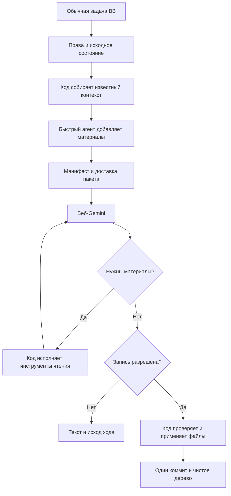

# provider-web-gemini — внутренний агент

## 1. Назначение и границы

Плагин `bb-plugin-provider-web-gemini` принимает обычную задачу BB, самостоятельно собирает материалы для сильной веб-модели и возвращает текстовый результат либо один коммит в рабочей ветке сессии. Отсутствие нативных инструментов у веб-модели закрывается внутри провайдера. Оркестратор не выбирает формат пакета или файлового ответа и не запускает посредника отдельно.

Контракт предназначен для ревью и аудита, архитектурных решений, исследования и написания спецификаций. Внутренний быстрый агент только дочитывает контекст; решение и содержимое результата создаёт веб-Gemini. Это не отдельный исполнитель оркестратора и не отдельная задача трекера.

Документ задаёт контракт PLUG-297. Исходный документный этап — PLUG-323, правки по просмотру архитектора — PLUG-325, правки по итогам пробы — PLUG-329. Решение и альтернативы — [ADR 0034](../adr/0034-provider-web-gemini-inner-agent.md). Базовые контракты — [provider-argon r23](provider-argon.md), [инструменты веб-Gemini](provider-web-gemini-tools.md), [итог захода оркестратора §4.1](orchestrator.md#41-заходы-каждый--своя-копия-и-своя-ветка).

> [!IMPORTANT]
> Документ задаёт целевой контракт задачи BB. Правила полноты, восстановления, прав и передачи данных ниже имеют приоритет над r23 и спекой инструментов для этого пути. Для обычного чата продолжает действовать совместимый путь r23 (§6, §10). Правила пула, выбора веб-модели и аренды общие для обоих путей.

Изменения оркестратора и удаление его специальной сборки пакета зафиксированы в r34.4 (PLUG-316, ADR-0036) после подтверждения паритета коммитом `3eba8d1d`.

## 2. Опора на текущую реализацию

| Точка в репозитории | Уже существует | Требуемое расширение |
|---|---|---|
| [acp-server.mjs](../../plugins/bb-plugin-provider-web-gemini/acp-server.mjs) | `session/prompt`, очередь `enqueue`, `collectUploadFiles`, аренда и `session/update` | Стадии хода, права, сбор агентом, применение кодом, постоянный журнал |
| [src/web-tools.mjs](../../plugins/bb-plugin-provider-web-gemini/src/web-tools.mjs) | `packFirstMessage`, `writeSpillPackage`, `executeTool`, `runToolLoop` | Неизменяемое ядро, манифест полноты, добавления агента; защита доставки от усечения |
| [src/gemini-driver.js](../../plugins/bb-plugin-provider-web-gemini/src/gemini-driver.js) | `sendPrompt`, `files`, `onChunk`, извлечение `convId`, остановка и парковка. Текст из `message-content.innerText` уже прошёл рендеринг Markdown | Проверяемое восстановление, события ожидания генерации, обязательный захват сырого ответа для файлов (§8.1). Вердикт извлекается по §6 |
| [index.mjs](../../plugins/bb-plugin-provider-web-gemini/index.mjs) | Регистрация ACP-провайдера и legacy-алиаса, сейчас только `full` | Регистрация прав, передача доверенного идентификатора BB-треда |

В r23 `session/load` восстанавливает запись лишь из памяти процесса, неизвестная сессия становится пустой; `session/set_mode` отвечает без изменения прав. Это недостаточно для настоящего продолжения и пишущей сессии. Существующие ограничения путей и белый список инструментов остаются обязательными, а не заменяются доверием к быстрому агенту.

## 3. Жизненный цикл хода



Отключение быстрого агента пропускает только стадию D. Для всех стадий действуют единый дедлайн, отмена, журнал и события хода. Ошибка приводит к терминальному исходу по §11; после начала записи сначала выполняется восстановление по §8.

Очередь сервера сериализует обращения к браузеру. Пишущая транзакция дополнительно захватывает межпроцессную блокировку рабочей копии (§8.2). Продолжение и повторная доставка используют устойчивый ключ хода и номер попытки (§7.2–7.3).

## 4. Контекст: сначала код, затем дополнения

### 4.1 Неизменяемое ядро

Код до запуска быстрого агента фиксирует доступное из входа: полный текст задачи, встроенные ресурсы, приложенные файлы, явно указанные ссылки и дифф. Для обычного контекста фиксируется статус репозитория, для ревью — ревизия по правилам ниже. В обычной задаче BB инструкции пресета и раздачи входят в пользовательский текст. Согласно PLUG-285 блок `<system_instructions>` целиком исключается из исходящих материалов. До фильтрации код может извлечь из первого служебного блока только признак договора вердикта по §6.

Для проверки результата код читает стандартную строку «Проверяемый итог: коммит <ref>» или `Result under review: commit <ref>` из секции дополнительных инструкций обычной задачи. Синтаксис задан [шаблонами оркестратора](../../plugins/bb-plugin-orchestrator/src/i18n/ru.ts) и [английскими шаблонами](../../plugins/bb-plugin-orchestrator/src/i18n/en.ts). Суффикс с веткой и заходом справочный. Как и `--from` в §4.1 оркестратора, `<ref>` принимает локально доступный commit-ish, включая SHA и имя ветки. Код передаёт его отдельным аргументом в `git rev-parse --verify --end-of-options <ref>^{commit}` без shell, checkout и fetch. Ошибка, предупреждение о неоднозначности, результат вне типа commit или конфликтующие итоговые SHA дают предварительный отказ с причиной. Полученный полный SHA фиксируется в журнале. Для задач без указанного результата упаковывается обычный контекст `cwd` с состоянием индекса и рабочего дерева.

Для проверяемого коммита целевая ветка берётся из `environment.mergeBaseBranch` доверенного запроса BB (§6), затем `environment.baseBranch`, при отсутствии обоих — из локального remote-tracking `origin/HEAD`. Имя без префикса разрешается сначала как remote-tracking ref, затем как одноимённая локальная ветка. Полный ref или явно заданный SHA базы разрешается напрямую. Код фиксирует единственный результат `git merge-base --all` цели и проверяемого SHA. Если опорный ref или основание не разрешаются однозначно, ревью коммита отклоняется с причиной.

Ядро провайдера формирует собственный пакет контекста (по ADR-0034) и получает `git diff --stat` и текстовый `git diff -U10` между зафиксированными SHA. Оба вызова используют `--no-ext-diff` и `--no-textconv` и исключают конфиденциальные пути, lock-файлы (`*.lock`, `*-lock.json`, `*-lock.yaml`, `bun.lockb`, `npm-shrinkwrap.json`, `go.sum`) и деревья `dist/`, `node_modules/`. Двоичные изменения остаются только в статистике. Опись показывает причины исключений, а для чувствительных путей — безопасную сводку без имён.

Пути из стандартной строки «Приложенные файлы (прочитай в репозитории)» или `Attached files (read them in the repo)` в дополнительных инструкциях код читает из проверяемого коммита, при отсутствии ссылки — из снимка `cwd`. Вложения трекера из секции `Attachments` сверяются по ID с текущей карточкой этой задачи через BB Tasks и скачиваются существующей командой `bb tasks attachment get` в state-каталог с проверкой размеров (§4.4, §10). Это кодовый путь для явных вложений. Быстрый агент к трекеру и путям вложений не обращается.

Сначала проверяются доступ и чувствительные пути, затем маскируются данные (§10), затем фиксируются байты и хэши ядра. Неизменяемость относится к этому разрешённому к передаче представлению, а не к секретам до маскировки. Каждый элемент получает источник, относительный путь или безопасную ссылку, диапазон/ревизию, длину, SHA-256 и признак обязательности. Входные материалы обязательны; автоматически обнаруженные дополнительные кандидаты учитываются отдельно.

Код раскрывает поддерживаемые ссылки существующими инструментами, без произвольного сетевого загрузчика. Неподдерживаемая URL-ссылка остаётся ссылкой с отметкой «содержимое не прочитано». Уже переданный оркестратором пакет принимается как входной материал целиком; повторная сборка не должна терять его части.

Ядро хранится отдельно от дополнений. Агент не может удалить, сократить, заменить, переформулировать или переупорядочить его части. Дедупликация допустима только для доказанно одинаковых байтов с сохранением всех источников в манифесте. Исходный текст задачи и дифф не пересказываются для экономии места.

Для ревью коммита явные пути, `read_file`, `list_dir` и `grep` используют один источник — дерево закреплённого SHA. Исполнитель читает Git-объекты из репозитория сессии. `read_file` возвращает blob обычного файла, `list_dir` перечисляет дерево, `grep` ищет по тому же SHA. В этом режиме проверки относительных путей и чувствительных имён применяются к дереву Git. Переход через симлинк, чтение из submodule и резервное чтение из рабочего дерева запрещены. Отсутствующий в снимке путь помечается в описи с указанием SHA, даже если он есть в `cwd`.

Для разрешённого `git` в ревью `show`, `log`, `blame` по умолчанию читают закреплённый SHA, `diff` — диапазон от зафиксированного merge-base до этого SHA. Явные ревизии для этих команд разрешаются только к зафиксированным SHA или их предкам и подставляются полными хэшами после проверки. `ls-files` перечисляет пути снимка, `status` описывает выбранную ревизию и сообщает, что индекс и рабочее дерево в этот контекст не входят. Сравнение с индексом или рабочим деревом отклоняется. Опись указывает SHA или фактически использованный диапазон ревизий для каждого результата, включая дозапрос и восстановление хода.

### 4.2 Быстрый агент чтения

Быстрый дешёвый агент получает задачу, опись ядра, доступные материалы и остаток бюджета. Он определяет, каких файлов, фрагментов и сведений о репозитории не хватает, и запрашивает их через инструменты чтения. Код выполняет запросы и добавляет исходный результат инструмента в пакет; пересказ агента не заменяет прочитанный материал.

Агент ограничен репозиторием сессии, источником чтения по §4.1 и теми же проверками `read_file`, `list_dir`, `grep` и разрешённого `git`, что и веб-цикл. Дополнительные корни вложений находятся вне его области чтения. Полномочия определяются кодом и сохраняются при обработке любых данных из инструментов.

Код вызывает настроенный OpenAI-совместимый шлюз по правилам транспорта §9, `POST` к `gateway.baseUrl` + `/chat/completions`. Запрос без стриминга содержит `model`, `messages` с маскированной задачей, описью и контекстом и четыре функции в `tools`. Точные параметры соответствуют [каталогу инструментов §4](provider-web-gemini-tools.md#4-каталог-инструментов-только-для-чтения): `read_file(path, from?, to?)`, `list_dir(path?)`, `grep(pattern, path?)`, `git(args)`. Имена путей, шаблон и `args` — строки, номера строк — положительные целые числа. Схемы запрещают дополнительные поля.

Код принимает `choices[0].message`. Каждый вызов из `tool_calls` проверяется по имени, уникальному `id` и JSON-аргументам. Код вызывает существующий исполнитель чтения и отвечает сообщением `role: tool` с тем же `tool_call_id` и маскированным результатом или диагностикой. Дополнения формируются из сохранённых результатов этих вызовов. Ответ без вызовов завершает сбор, а свободный текст агента не становится материалом задачи. Каждый вызов, включая отклонённый, расходует лимит. Ошибка транспорта, схемы или истечение бюджета обрабатываются по правилу ниже.

Модель и шлюз задаются только настройками плагина (§9). При отключении сбора агентом код всё равно собирает ядро, подписывает пакет и запускает обычный дозапрос. При ошибке/таймауте быстрого агента сохраняются ядро и уже проверенные дополнения, причина видна в манифесте и событиях; допускается продолжение веб-цикла при полной доставке обязательного ядра. Неявная подмена другой моделью или шлюзом запрещена.

### 4.3 Подписанный пакет: «вошло / не вошло»

Здесь подпись — сформированная кодом проверяемая опись происхождения и полноты с SHA-256, а не криптографическое удостоверение личности модели. Состав пакета версионируется; подпись не генерируется быстрым агентом.

| Часть | Содержание |
|---|---|
| Заголовок | Версия формата, отпечаток задачи, исходная ревизия, права и ожидаемый вид результата |
| Ядро | Полные разрешённые материалы, упакованные кодом; собственный хэш ядра |
| Дополнения | Материалы чтения быстрого агента с источниками, диапазонами и хэшами |
| «Вошло» | Элемент, источник, полное/частичное включение, точный диапазон, размер, хэш, место доставки: текст или вложение |
| «Не вошло» | Элемент/непокрытый диапазон, причина: запрет доступа, секрет, нет файла, неподдерживаемая ссылка, лимит, ошибка; способ дозапроса, если он возможен |

В заголовке описи отдельная строка `проверяемый коммит: <SHA>` с полным закреплённым SHA из §4.1. Для задачи без проверяемого коммита строка имеет вид `проверяемый коммит: не указан, упакована рабочая копия`.

Манифест является концом пакета и доступен веб-модели вместе с материалами. Хэш всего доставляемого пакета вычисляется по окончательным байтам после маскировки и хранится в журнале вне хэшируемого тела; это исключает самоссылку хэша. Состояние отдельно различает «собрано», «отправлено» и «загрузка подтверждена»: локальный файл ещё не доказывает доставку.

Обязательное ядро нельзя вытеснить дополнениями. При нехватке места дополнения получают явную отметку неполноты, а полное ядро переливается в веб-вложение. Если полное ядро не доставляется даже через spill, ход заканчивается ошибкой с перечнем недоставленного; тихое усечение задачи или диффа запрещено. Ограничения доступа не обходятся ради полноты; недоступный материал перечисляется с причиной. Если без него нельзя получить требуемый результат, исход не может быть успешным.

### 4.4 Доставка и пределы

Используются существующие `packFirstMessage`, `writeSpillPackage`, массив `uploadFiles` и `sendPrompt({ files })`. Короткий текст содержит задачу или указатель на её полный файл, инструкцию прочитать пакет и указатель на манифест. Длинный текст задачи также переливается целиком. Ошибка spill или загрузки обязательного файла — ошибка хода, а не возврат к усечённому ядру.

Текстовый предел `WEB_GEMINI_MAX_MESSAGE_BYTES` согласуется с `WEB_GEMINI_MAX_PROMPT_BYTES` и запасом `effectiveMessageBytes`; spill не отменяет предела textbox. Пользовательские вложения сохраняют лимиты количества и размера. Служебный пакет по существующему контракту не расходует пользовательскую квоту файлов, но учитывается в отдельном общем бюджете контекста (§9); бесконечного обхода ограничений нет.

Выводы ограниченных инструментов могут быть частичными. Манифест явно перечисляет прочитанные и пропущенные диапазоны; для обязательного диффа/материала код дочитывает части или упаковывает полный разрешённый снимок, а не объявляет первые 60 КБ полным файлом. Полнота означает точность описи известных материалов, а не обещание прочитать весь репозиторий.

## 5. Мысль и дозапрос веб-модели

Веб-Gemini получает подписанный пакет и протокол существующих `<tool .../>`. Запросы `read_file`, `list_dir`, `grep` и разрешённого `git` выполняет код через `executeTool` внутри `runToolLoop`, без быстрого агента. Сохраняются белый список git (`show`, `diff`, `log`, `blame`, `ls-files`, `status`), sandbox и маскировка. Исполнитель получает тот же закреплённый источник чтения (§4.1), что и быстрый агент. Поддерживаемые `bb_*` раскрытия остаются на стороне кода по существующей валидации.

Все раунды идут в том же `convId` на том же backend под удерживаемой арендой. При подтверждённой невозможности восстановления разговор создаётся заново с полным сохранённым контекстом (§7), а не с одиночным последним запросом инструмента. Результаты чтения дописываются в журнал и опись контекста; ядро не меняется.

Лимиты числа раундов, размера результатов/сообщений и общего срока задаются настройками. После исчерпания раундов код может запросить финальный ответ на уже прочитанном материале, как сейчас. Это не гарантирует успех: оставшиеся теги инструментов, незавершённый файловый ответ или отсутствие нужного вердикта означают ошибку. Общий дедлайн не начинается заново на каждом раунде, исправлении формата или восстановлении.

## 6. Права сессии и результаты

| Режим | Классы задач | Разрешённый результат |
|---|---|---|
| `read-only` | Ревьюер/аудитор, архитектор, ресерчер | Текст; у ревью — исходный вердикт. Никакой записи/индексации/коммита в репозитории |
| `write` | Писатель спек или другой явно разрешённый пишущий исполнитель | Проверенные файлы и ровно один локальный коммит в своей ветке |

Обе регистрации в `index.mjs` объявляют поддерживаемые BB режимы `permissionModes: ["full", "accept-edits"]` с совместимым значением по умолчанию `full`. `acpLaunchSpec.permissionCli` использует `insertAfterArgs: 1`, `full: ["--session-access=read-only"]` и `workspaceWrite: ["--session-access=write"]`. Обычный пресет BB для писателя спек выбирает `permissionMode=accept-edits` и выделенную рабочую копию. Пресеты ревьюера, архитектора и ресерчера используют `full`, который у этого провайдера даёт только чтение. Роль не выводится из имени пресета, текста или ответа модели.

Для привязки к BB `deriveProviderOptions` дополняет существующий `acpLaunchSpec.args` доверенным `--bb-thread-id` из `ctx.threadId`. Сервер получает метаданные только этого треда и его рабочей копии из `bb thread show <id> --json`, используя фиксированный вызов CLI без shell. Для новых сессий путь задачи включается для тредов, созданных плагином BB (`thread.originPluginId` задан), либо при явном выборе запуска с правом `write`. Обычные чаты, созданные пользователем с режимом по умолчанию, сохраняют путь r23, даже если их `cwd` совпал с рабочей копией задачи. При недоступных метаданных объявленного BB-треда сервер выдаёт явный отказ. Без BB-треда доступны обычный чат и чтение.

`session/new` выбирает режим по пусковому флагу и сообщает только разрешённые режимы ACP. `session/load` выбирает пересечение прежних прав и пускового потолка. Запуск без известного пускового флага оставляет только чтение. `session/set_mode` принимает `read-only` и `write` в пределах того же потолка и объявленных режимов. ACP-режим `bypass` не объявляется. Попытка передать старое значение `bypass` или `full` через `session/set_mode` отклоняется с сохранением текущих прав. Действующий пресет `full` продолжает работать в чтении, даже если BB проверяет наличие опции `bypass`.

Эффективные права фиксируются на ход. Понижение прерывает активную пишущую транзакцию с восстановлением, повышение в пределах пускового потолка действует со следующего хода. Смена режима в BB, требующая перезапуска процесса моста, проходит через §7.3. Профиль задачи или чата сохраняется при восстановлении. Материалы задачи не участвуют в назначении прав.

Пишущий режим требует коммит и разбирает раздел файлового результата по §8.2. В режиме чтения этот раздел остаётся частью описания задачи, в том числе при ревью задачи писателя. Он не задаёт результат хода и не валидируется как разрешение на запись. При явном запросе режима `write` в сессии с потолком `read-only` отказ сообщает, что пресет `full` даёт только чтение и для файловой задачи нужен пресет с `accept-edits` и выделенной рабочей копией.

В режиме чтения строка проверяемого итога (§4.1), явный договор JSON-вердикта в задаче или стандартная обязательная строка `role.mand.auditor` из первого служебного блока означает, что ожидается вердикт. Код распознаёт русскую и английскую строки по [шаблонам оркестратора](../../plugins/bb-plugin-orchestrator/src/i18n/ru.ts) и [английским шаблонам](../../plugins/bb-plugin-orchestrator/src/i18n/en.ts). Из служебного блока сохраняется только этот булев признак. Он не меняет права сессии. Для остальных задач результатом служит текст.

При обязательном вердикте код сам добавляет к веб-запросу договор (по ADR-0034). После текста отчёта последней содержательной строкой должен идти отдельный JSON-объект без Markdown-ограды с `verdict` (`OK` или `CHANGES`) и `blockers` (целое неотрицательное число). Дополнительные явно заданные поля договора задачи, например `target` для архитектурной проверки, также передаются модели и проверяются. Договор включается при исходной отправке, при повторной доставке пакета и при запросе исправления. Служебный блок BB целиком не передаётся.

Код берёт последнюю содержательную строку из полного сырого ответа текущего сообщения, если он уже доступен. Иначе источником служит окончательный текст этого сообщения на странице. Код проверяет, что строка представляет собой JSON-объект с полями и значениями из договора, и передаёт найденную строку в итоговый ответ BB без пересказа моделью. Приёмка паритета сравнивает значения полей. При отсутствии строки или нарушении договора исправление запрашивается у веб-модели в пределах общего дедлайна. Чтение вердикта не требует двухканальной сверки. Служебные события закрываются до финального ответа.

Файловый ответ в `read-only` не применяется даже если он синтаксически корректен. Провайдер возвращает отказ в записи с той же подсказкой о правах. Текстовые предложения изменений в ревью остаются допустимым текстом.

## 7. События хода и восстановление

### 7.1 Признаки жизни

При получении `session/prompt` провайдер открывает один служебный `session/update` типа `tool_call` со стабильным для хода `toolCallId`, `kind: "other"` и `status: "in_progress"`. Он сообщает о стадиях предварительной проверки, очереди, сбора, доставки, генерации, дозапроса, проверки, записи, коммита и восстановления через `tool_call_update` с тем же ID. Вызовы чтения сохраняют собственные идентификаторы и события.

Во время всего незавершённого хода отдельный таймер публикует `tool_call_update` каждые `progressIntervalMs` (по умолчанию 15 секунд), включая очередь и ожидание первого текста. Промежуточное обновление содержит `status: "in_progress"` и стандартный текстовый блок `content` со стадией и прошедшим временем. На любом терминальном исходе таймер прекращается и вызов закрывается со статусом `completed` или `failed`.

Сырые дельты `onChunk` не являются источником файлов для применения или подтверждённым вердиктом. Конверт файлов и кандидаты исправления сохраняются внутри провайдера до проверки полноты и допустимости; наружу в это время идёт прогресс. Финальный текст передаётся чанками из проверенного полного ответа, без перемешивания с конвертами и служебными сообщениями. Это также исключает утечку запрещённых данных через ещё не проверенный поток.

ACP-мост должен преобразовывать эти обновления в видимые [сторожу оркестратора §5.1](orchestrator.md#51-первый-ответ-правило-n-секунд) `item/started` и `item/toolCall/progress`. Приёмка сверяет журнал BB на стороне потребителя. `agent_message_chunk` используется для проверенного итогового текста. События прогресса не продлевают общий дедлайн.

### 7.2 Постоянное состояние

В каталоге состояния плагина, выбранном `WEB_GEMINI_STATE_DIR` с существующим legacy-фолбэком `ARGON_STATE_DIR`, находятся `uploads/`, `downloads/` и постоянные записи сессий/ходов внутреннего агента. Все пакеты, манифесты, финальные ответы, извлечённые полезные байты файлов и журнал транзакции лежат там. Служебные файлы не создаются в рабочей копии.

Запись атомарная (временный файл и rename), доступ ограничен процессами провайдера. Перед изменением рабочих файлов запись журнала с исходным HEAD и планом отката синхронизируется с диском. Журнал сессии имеет стабильный исходный ACP `sessionId`, индекс по доверенному BB-треду и отпечаток рабочей копии. Для Git отпечаток включает канонический `cwd` и канонический Git-каталог конкретного worktree. Ключ хода — исходный ID сессии и монотонный номер хода, выделенный до внешней работы. Повторные попытки продолжения используют этот же ключ, отдельный номер попытки и SHA-256 нормализованного набора входных блоков и материалов для распознавания повтора.

Запись хода содержит версию схемы, стадию, профиль и права, исходные HEAD/ветку, закреплённые SHA ревью и merge-base при наличии, вид результата и признак договора вердикта, хэши пакета и материалов, подтверждённую доставку, связь с `convId` и backend, историю дозапросов/ответов, использованные бюджеты, план файлов и итоговый SHA/исход. При восстановлении ветка из строки проверяемого итога заново не разрешается. Секреты шлюза в журнал не попадают.

Текущую чистку uploads/downloads по возрасту и количеству требуется дополнить учётом ссылок из незавершённых ходов. Активные пакеты, ответы и журналы не удаляются. После завершения действует настраиваемый срок хранения; при истёкшем состоянии нельзя молча выдавать новую пустую сессию за восстановленную.

### 7.3 «Продолжай» и повторная доставка

После реализации постоянного журнала `initialize` объявляет `agentCapabilities.loadSession: true`, чтобы BB вызвал `session/load` при возобновлении. `session/load` находит запись по переданному ACP `sessionId`, проверяет владельца BB, `cwd` и права. Неизвестная запись или несовпадение дают ошибку восстановления. Тяжёлое восстановление транзакции и разговора выполняется при `session/prompt` с событиями хода.

Если мост после неудачного `session/load` вызвал `session/new`, сервер проверяет журнал по паре «доверенный BB-тред + отпечаток рабочей копии». При единственной совпавшей сессии новый транспортный ID становится алиасом исходной записи. Наличие того же каталога без совпадения BB-треда не даёт доступа к журналу. Неоднозначная, повреждённая или просроченная запись блокирует продолжение с диагностикой. Без найденного пакета пустая сессия может принять полную новую задачу. Вход из одного «продолжай» или уже существующего напоминания BB о прерванном ходе/вердикте в этом случае отклоняется.

При продолжении проверяются версия записи и целостность пакета. При доступном `convId` на прежнем backend восстанавливается разговор с проверкой доступности его истории. Сам факт ненулевого `convId` не доказывает восстановление.

Если разговор недоступен, в новый чат передаются сохранённый пакет целиком, дополнения и результаты дозапросов, существенная история ответов и последнее поручение/напоминание. Смена backend требует повторной доставки вложений и новой проверки полноты. Одиночное «продолжай» в пустой чат не отправляется. Если исходный пакет утрачен или контекст не помещается, ход явно завершается ошибкой восстановления.

После рестарта незавершённая запись файлов сначала откатывается под блокировкой (§8.4). Если продолжение или точный повтор входа относится к сохранённому пишущему ходу, у которого коммит уже создан, код сверяет родителя, ветку, HEAD, хэши и чистоту дерева и выдаёт прежний SHA. Это покрывает падение после commit до доставки ответа BB. Полная новая задача с другим отпечатком получает новый номер хода после восстановления старой транзакции.

## 8. Применение: только код и одна транзакция

### 8.1 Формат файлового ответа

Для первой реализации выбран полный текст файлов, без патчей. Плагин задаёт веб-модели версионированный JSON-конверт: `format` со значением `web-gemini-files-v1`, поле `nonce` со случайным маркером хода, непустой массив `files` и строка `commitMessage`. Каждая запись `files` содержит `path` (относительно корня репозитория), `operation` (`create`, `replace`, `delete`), `baseSha256` (для существующего файла) и `content` (полный текст для создания/замены). Пустой файл отличается от отсутствующего `content`; для удаления содержимого нет, для `create` значение `baseSha256` равно `null`.

Хэш базы существующего файла вычисляет код по его полным исходным байтам и передаёт веб-модели с материалом чтения; модель только возвращает полученное значение. Этот хэш отличается по назначению от хэша маскированного контекста. Если для изменяемого файла не получен хэш базы, модель сначала дозапрашивает материал; ей не предлагается вычислять SHA-256 самостоятельно.

Веб-модель обязана вернуть ответ, содержащий ровно **одну** Markdown-ограду с языковой меткой `json` (наличие текста вне ограды, нескольких кодовых оград или разделение ответа на несколько сообщений запрещено и ведёт к отказу).

Кнопка «Копировать ответ» и вызов Clipboard API полностью удалены из контракта: живая проба показала, что обращение к буферу обмена искажает полезные байты файлов в 2/3 ответов. Для содержимого файлов обязателен сырой текст ответа веб-модели до Markdown-рендеринга, захватываемый одновременно по **двум независимым каналам**:
1. Сохранённый ответ Gemini из RPC истории разговора (`hNvQHb`) — контрактный канал. Сетевой поток CDP в проведённой пробе не измерялся; его использование в качестве альтернативного источника допускается только после собственной побайтовой пробы.
2. `textContent` блока кода Markdown-ограды в DOM на странице чата (чтение через CDP из дерева сообщения текущего хода).

Полный сырой текст JSON из RPC истории и `textContent` из DOM расходятся ровно на один конечный LF перед закрывающей кодовой оградой (`textContent` захватывает перевод строки перед закрывающими обратными апострофами, тогда как RPC истории его не содержит). Поэтому побайтовое сравнение и сверка хэшей проводятся не над внешним синтаксическим обрамлением ограды, а над полезным значением `content` файлов после декодирования JSON из каждого канала.

Правило записи и порядок обработки отказов (двухканальная сверка):
- Код проверяет корректность JSON, совпадение значения `nonce` со случайным маркером, выданным кодом на текущий ход, единственность сообщения и единственность кодовой ограды в обоих каналах.
- Для каждого файла извлекается полезный `content` и вычисляется его SHA-256 независимо по обоим каналам.
- Если полезный `content` каждого файла из обоих каналов побайтно совпадает по хэшу (`SHA256(content_канал1) === SHA256(content_канал2)`), план допускается к валидации и записи.
- **Расхождение каналов или отсутствие канала**: если хэши `content` расходятся либо отсутствует один из каналов, код сначала выполняет **один повторный захват обоих каналов** (возможный сбой чтения или тайминга интерфейса, модель в этом не виновата). Если и после повторного захвата каналы расходятся или недоступны, код инициирует запрос исправления у веб-модели.
- **Ошибка формата или `nonce`**: если `nonce` не совпадает с выданным, нарушен формат JSON, отсутствуют обязательные поля, ответ содержит несколько сообщений или лишние ограды — код сразу инициирует запрос исправления у веб-модели в пределах лимита попыток (`apply.maxRepairRounds`).
- **Терминальный исход `failed`**: выставляется только после исчерпания лимитов попыток исправления/повторов или превышения общего дедлайна хода (§9).
- **Один канал без сверки со вторым источником не считается и права на запись не даёт.**

`innerText`, HTML, `onChunk` и восстановленный из них Markdown не служат источником байтов файлов. Для вердикта действует §6. Текст обычного чата по r23 по-прежнему читается существующим путём. Формат Base64 в контракте не фиксируется (отклонён архитектором: ошибки кодирования Base64 моделью недетектируемы).

Код проверяет корректность Unicode и сохраняет сырой ответ в UTF-8 вместе с идентификатором сообщения, проверенным `nonce` и SHA-256 полезных блоков. В пишущей сессии допускается один JSON-конверт целиком, с необязательным внешним пробельным обрамлением JSON. Дубли путей/ключей, неизвестные операции, некорректный Unicode в декодированных полях или недостающие поля отвергаются. Все файлы сначала валидируются, затем применяется весь план.

Полезные байты файла определены однозначно: результат стандартного декодирования JSON-строки `content`, закодированный в UTF-8. Экранирование JSON — транспорт, не изменение содержания. После извлечения не допускаются trim, добавление конечного перевода строки, замена LF/CRLF, форматирование, исправление орфографии или пересказ. Верификатор не выводит «ожидаемый» хэш из уже записанного файла.

Код составляет запрос на исправление при сломанном формате, неправильной базе, несовпадении nonce или неустранимом расхождении каналов после повторного захвата. Он передаёт веб-модели диагностику и разрешённое представление ошибочного ответа по §10. Веб-модель создаёт полный исправленный ответ. Ход завершается `failed`, только если исчерпаны лимиты попыток (`apply.maxRepairRounds`) или общий дедлайн хода.

Поддержка патчей не входит в первый формат. Если она будет добавлена отдельным контрактом, применение обязан выполнять код с проверкой базы, однозначности применения и хэшей итоговых байтов; свободное исправление патча посредником недопустимо.

### 8.2 Подготовка и проверки

В предварительной проверке пишущего хода код захватывает блокировку и фиксирует исходные HEAD, имя ветки, индекс и состояние дерева. Эта база сохраняется на весь ход и повторно проверяется перед первой записью. Требуются выделенный управляемый BB worktree из метаданных §6 с каноническим `cwd`, совпадающим с корнем `environment.path`, совпадающая с `environment.branchName` именованная ветка, чистая копия по §4.1 оркестратора и заданный автор git. Неотслеживаемый каталог или ссылка `node_modules` не считается грязью и исключается из записи. Git-игнорируемые пути также вне области записи. Грязная копия или detached HEAD дают отказ до записи.

Блокировка — эксклюзивный файловый lock ядра (например, `flock(2)`) на стабильном файле `locks/<sha256-отпечатка-worktree>.lock` в общем для процессов провайдера state-каталоге. Файл блокировки сохраняется по завершении, освобождается дескриптор. Транзакция и её дочерние операции записи удерживают lock до завершения или выхода последнего пишущего процесса. Само существование файла не означает занятую копию. Если lock занят или платформа не может гарантировать его межпроцессную эксклюзивность, запись не начинается. Возраст lock и PID из журнала не дают права отобрать занятый lock.

Базовая область записи — обычные текстовые файлы в корне выделенного worktree и его подкаталогах после проверок ниже. Только в режиме `write` код разбирает раздел `## Файлы результата` в описании задачи как ограничение записи. В разделе допускается по одному точному относительному пути на строке Markdown-списка (`- docs/example.md`). Если раздел отсутствует, действует базовая область. Пустой, повторный или некорректный раздел в режиме `write` отклоняется до внешней работы. Модель получает проверенный перечень и не может расширить его своим ответом.

Код проверяет каждый путь относительно корня, в том числе реальные родительские каталоги нового файла. Запрещены абсолютные пути, выход из корня, симлинки в любом компоненте, чувствительные пути, `.git`, служебное состояние, submodule и бинарные файлы. Формат сохраняет режим существующего файла и создаёт обычный неисполняемый файл.

Для `replace`/`delete` хэш фактического исходного файла должен совпасть с `baseSha256`, для `create` файл должен отсутствовать. Базовый файл для операции `replace` с не-NFC текстом (содержащий декомпозированные символы Unicode, такие как `e` + U+0301) вызывает отказ до записи с фиксацией причины в описи: в веб-окружении зафиксирована нормализация декомпозированного Unicode в форму NFC (замена видна уже в сохранённом промпте; место нормализации между браузерным вводом и хранением Gemini не установлено), поэтому модификация не-NFC файлов привела бы к искажению исходных байтов. Состояние сверяется повторно перед записью и коммитом. Сообщение коммита проходит правила репозитория; автор берётся из git config без подмены, соавторских трейлеров и обхода хуков. Push, PR и merge не входят в ход.

### 8.3 Запись и дословность

Код сохраняет журнал намерений до изменения файлов. Источник исходных байтов и режимов Git для отката — зафиксированный исходный HEAD. Перед записью код сверяет байты и режимы Git из этого коммита с индексом и рабочими файлами плана. Расхождение, в том числе из-за фильтра или преобразования окончаний строк, отклоняет план до изменений. Фактические файловые права затронутых путей фиксируются в журнале. Полный проверенный план применяется с атомарной заменой отдельных файлов; частично применённый набор никогда не считается готовым результатом. Для staging используются только пути из плана, без `git add .`.

Понятие дословности означает строгое сохранение полезных байтов, которые фактически **выдала** модель в сохранённом ответе (декодированное значение поля `content` в UTF-8), а не предполагаемых исходных или «желаемых» байтов. В веб-окружении зафиксирована нормализация Unicode в форму NFC (в пробе `e` + U+0301 превращается в U+00E9 уже в сохранённом промпте; место нормализации между браузерным вводом и хранением Gemini не установлено); кроме того, возможна замена CRLF на LF вне JSON-строки (в синтаксисе внешнего обрамления). При этом переводы строк CRLF внутри самой JSON-строки `content` сохраняются побайтно без изменений (проверено фикстурой).

Веб-модель не вычисляет и не возвращает независимый SHA-256 для создаваемых и заменяемых файлов. Источником контрольного хэша для сверки служат сами каналы ответа: побайтовое совпадение декодированного `content` между каналом RPC истории `hNvQHb` и каналом `textContent` блока кода DOM (альтернативный сетевой поток CDP допускается только после отдельной побайтовой пробы).

Для каждого созданного/заменённого файла обязателен инвариант:

```text
SHA256(content из RPC истории hNvQHb)
  = SHA256(content из DOM textContent блока кода)
  = SHA256(байты рабочего файла)
  = SHA256(байты blob в индексе)
  = SHA256(байты blob в итоговом коммите)
```

Это SHA-256 содержимого, а не внутренний object id Git. Удаления проверяются отсутствием пути в индексе и итоговом дереве. Остальные файлы должны совпадать с исходным деревом; состав staged diff — ровно план. Фильтры Git, преобразование окончаний строк и хуки не могут незаметно менять результат: при расхождении — отказ и восстановление, а не подмена ожидаемого хэша.

Все доступные проверки выполняются до финального коммита; после него проверяются фактические blob, родитель и чистота. Пустой diff для пишущей задачи, ожидающей артефакт, не заменяется пустым коммитом и не считается выполнением.

### 8.4 Один коммит, ошибка и откат

В конце создаётся **ровно один локальный коммит**, его единственный родитель — зафиксированный исходный HEAD; имя ветки сохраняется, дерево и индекс чистые. Ответ содержит ветку и SHA. Это соответствует [orchestrator §4.1](orchestrator.md#41-заходы-каждый--своя-копия-и-своя-ветка). Промежуточных коммитов, amend и публикации нет.

Ошибка, отмена или дедлайн после начала записи запускают откат по журналу к исходным HEAD, индексу и дереву. Код восстанавливает исходные версии затронутых путей из исходного коммита, возвращает файловые права по журналу и удаляет только пути, созданные транзакцией. Если проверка после commit обнаружила ошибку, откатывается и собственный итоговый коммит при условии, что ветка всё ещё указывает ровно на него. Откат ссылки выполняется с проверкой ожидаемого значения; чужой HEAD не перемещается.

Блокировка удерживается до подтверждения чистоты или до фиксации ошибки восстановления. После аварии первый процесс, захвативший lock, сверяет HEAD, индекс и затронутые пути с исходным и ожидаемым состоянием журнала и завершает проверку коммита либо адресный откат. Отмена до записи сохраняет рабочую копию. Отмена адресована своему ходу.

Если состояние расходится с журналом или хранилище мешает откату, провайдер сохраняет журнал с признаком `recovery_required` и возвращает `failed` с диагностикой. Пока признак активен, любое новое применение запрещено даже после освобождения файловой блокировки. Оператор устраняет причину по диагностике, сохраняя чужую работу, и повторяет ход. Повтор под lock автоматически снимает признак только после проверки единственного итогового коммита либо восстановления исходного HEAD, индекса и чистого дерева.

## 9. Настройки плагина

Сервер читает `inner-agent.json` из каталога состояния плагина (§7.2) и валидирует настройки при входе в путь задачи. Отсутствующий файл означает значения по умолчанию. Снимок настроек фиксируется на ход. Модель веб-Gemini и её уровень мышления по-прежнему выбираются через опции сессии.

| Настройка | Значение / действие |
|---|---|
| `innerAgent.enabled` | По умолчанию `false`: выключает только дополнительный агентский сбор |
| `innerAgent.model`, `innerAgent.gateway.model` | При включённом сборе указывают строковый идентификатор модели в одном из этих полей. Если указаны оба, значения должны совпадать |
| `innerAgent.gateway.baseUrl`, `innerAgent.gateway.tokenEnv` | При включённом сборе обязателен базовый URL шлюза с префиксом API. `tokenEnv` задаёт имя переменной окружения с токеном. Для HTTP-прокси на loopback это поле можно опустить |
| `innerAgent.maxCalls`, `innerAgent.maxRounds` | Лимиты вызовов инструментов и запросов к шлюзу. По умолчанию `maxCalls` равен 16, `maxRounds` равен `maxCalls` |
| `innerAgent.maxBytes`, `innerAgent.timeoutMs` | По умолчанию 240 000 байт дополнений и 60 000 мс. Общий дедлайн имеет приоритет |
| `context.maxTotalBytes`, `apply.maxRepairRounds` | По умолчанию 25 000 000 байт всего исходящего контекста с вложениями и 2 повторных запроса исправления; превышение не разрешает усечение обязательного ядра |
| `context.maskPatterns` | Дополнительные шаблоны по ID проекта BB. Каждый задаёт `type` для метки и `pattern` как регулярное выражение. Код проверяет синтаксис при загрузке настроек и заменяет все совпадения на `[скрыто: <type>]`. Без настройки применяются встроенные правила |
| `progressIntervalMs`, `state.retentionMs` | По умолчанию 15 000 мс между событиями и 86 400 000 мс хранения завершённых ходов; активное восстановление защищено от чистки |

Для удалённого шлюза обязателен HTTPS. HTTP разрешён для явно настроенного локального прокси по адресу `127.0.0.1` или `[::1]`. Соединение в этом случае идёт напрямую к указанному loopback-адресу, без сетевых прокси и DNS. Для обоих транспортов запрещены перенаправления и учётные данные в URL.

Код берёт токен из окружения ACP-процесса на хосте провайдера и передаёт только заголовком `Authorization: Bearer` настроенному шлюзу. При разрешённом отсутствии `tokenEnv` заголовок пропускается. Адрес и выбор модели поступают из state-конфигурации, токен отсутствует в ней, аргументах запуска и журналах. При включённом агенте ошибка конфигурации обнаруживается в предварительной проверке. Выключенный агент не требует этих полей. Бюджеты — конечные положительные целые числа. Ноль допустим для повторных исправлений.

Сохраняются существующие настройки `WEB_GEMINI_MAX_TOOL_ROUNDS` (8), `WEB_GEMINI_TOOL_TIMEOUT_MS` (15 000 мс), `WEB_GEMINI_MAX_MESSAGE_BYTES` (120 000 байт с ограничением через `effectiveMessageBytes`), `WEB_GEMINI_MAX_PROMPT_BYTES`, лимиты upload/download и их существующие `ARGON_*`-фолбэки. `MAX_TOOL_RESULT_BYTES` сейчас равен 60 000 байт; частичность всегда маркируется.

`WEB_GEMINI_SEND_DEADLINE_MS` (1 200 000 мс) охватывает весь внутренний ход, включая сбор и исправления; `GEMINI_MAX_WAIT_MS` (900 000 мс) ограничивает одну генерацию и не продлевает общий срок. Время и счётчики сохраняются для восстановления. Безопасное завершение/откат выполняются и при исчерпании вычислительного бюджета. Уменьшение лимитов между ходами не даёт разрешения терять ранее обязательный контекст.

## 10. Защита данных и гигиена

На пути задачи BB (§6) все исходящие данные проходят политику допуска **до** передачи быстрому агенту через шлюз и веб-Gemini. Это касается текста задачи, раскрытых ссылок, диффа, встроенных ресурсов, вложений, spill, результатов чтения и диагностических запросов. Код проверяет чувствительные пути и границы источника, затем применяет маскировку. Исходные значения секретов не попадают в опись.

Источник встроенных шаблонов — `maskForWeb` в [инструментах провайдера](../../plugins/bb-plugin-provider-web-gemini/src/web-tools.mjs) с необходимыми дополнениями до покрытия `maskLeakText` в [сканере утечек оркестратора](../../plugins/bb-plugin-orchestrator/src/scan.ts) и его правил в [leak-scan.ts](../../plugins/bb-plugin-orchestrator/hooks/leak-scan.ts). Правила исполняются кодом провайдера. Проектные `context.maskPatterns` дополняют встроенную маскировку. Исключения и уровни строгости выкладки (например, `leaks.allow`) не ослабляют допуск во внешний сервис.

Паритет проверяется на одних и тех же синтетических входах. В приёмке `maskLeakText` запускается с настройками проекта, которые передаёт ему [`packetMask`](../../plugins/bb-plugin-orchestrator/server.ts), включая `threadIds`, `allowedEmails` и `leaks.allow`. Для каждого фрагмента, скрытого правилами маскировки оркестратора (`maskLeakText`), исходное значение должно отсутствовать в пакете провайдера и в фактических исходящих запросах к вебу и шлюзу. Более строгая маскировка допустима при сохранении обязательного контекста в объёме, разрешённом к передаче. Отдельно проверяется добавленный проектный шаблон, включая дописки агента, результаты дозапроса и повторную доставку.

Для пути задачи этот раздел имеет приоритет над r23 §2.2, §2.4 и спекой инструментов §6 п.3 даже при `innerAgent.enabled=false`. Текстовое вложение отправляется как проверенная маскированная копия из state-каталога. Бинарное вложение в первой версии учитывается в описи с причиной отказа в передаче. Если оно обязательное, ход завершается ошибкой. В обычном чате без пути задачи сохраняется поведение явно приложенных пользователем файлов, включая изображения, по [PLUG-291 в r23 §2.4](provider-argon.md#24-веб-вложения-файлов-plug-291). На этом пути агентский сбор и запись отсутствуют.

Логи, прогресс и ошибки не содержат значений секретов или полного чувствительного исходного ответа. Ответ с запрещёнными к публикации данными не исправляется маскировкой во время записи: иначе нарушится дословность. Он отклоняется, а исправленный ответ запрашивается у веб-модели. Служебное состояние имеет ограниченные права и срок хранения.

Публичные документы, примеры, фикстуры и создаваемые артефакты не включают реальные идентификаторы тредов, абсолютные пути машины или имена учётных записей. Пути репозитория — относительные. Динамические внутренние идентификаторы состояния не копируются в коммит или итоговые документы.

## 11. Три исхода хода

| Исход | Условие | Внешний результат |
|---|---|---|
| `passed` — прошло | Полный допустимый текстовый результат/вердикт, либо проверенный единственный коммит и чистое дерево | Обычный успешный ход ACP с `stopReason: end_turn`; текст или ветка + SHA |
| `failed` — упало | Ход прошёл предварительную проверку, но результата нет из-за отказа сбора, генерации, доставки, применения, восстановления или отмены | JSON-RPC ошибка с `error.data.outcome: "failed"`. При активной отмене — `stopReason: cancelled` и исход в событии прогресса |
| `not_started` — не запускалось | Предварительная проверка отклонила вход, конфигурацию, права или рабочую копию либо ход отменён до её прохождения | JSON-RPC ошибка с `error.data.outcome: "not_started"` и причиной |

При ошибке `error.message` начинается с `[web-gemini:failed]` или `[web-gemini:not_started]`, поскольку ACP-мост BB передаёт текст ошибки и может отбросить `error.data`. Исход, причина и стадия также хранятся в журнале. При активной отмене провайдер отправляет заключительный `tool_call_update` с префиксом `[web-gemini:failed]` в тексте прогресса перед закрытием вызова и возвратом `cancelled`. Интеграционная проверка сверяет категорию и причину в событиях BB.

Пустой ответ, один heartbeat, файл только в downloads, оставшийся вызов инструмента или текст «готово» без ожидаемого артефакта — не `passed`. Обязательный вид результата определяется по §6. Ревью без требуемой строки вердикта не объявляется успешным.

## 12. Приёмка и порядок включения

До реализации проходят ревью спеки и ADR и просмотр документного SHA архитектором. У каждого среза свои критерии приёмки. Офлайн-проверки используют подставные модели и временный Git-репозиторий. Интеграционные проверки наблюдают итог на стороне BB. Реализация каждого среза проходит ревью кода.

### 12.0 Срез 0. Двухканальная проба сырого ответа (выполнена)

Живая проба проведена на живом веб-стенде Chrome (Argon/Neon, High thinking, драйвер `sendPrompt`, задача пробы PLUG-326, раунд 3). Проверялись фикстуры: Markdown-спека с оградами кода (~30 КБ), пустой файл, файл без конечного LF, вложенные ограды и CRLF, а также контрольный случай с неверным `nonce`. Сравнивались два независимых канала захвата сырого ответа: сохранённый ответ Gemini из RPC истории (`hNvQHb`) и `textContent` блока кода Markdown-ограды в DOM на странице чата.

Факты и результаты пробы:
- **Совпадение каналов — 7/7 ответов.** Полезный `content` файлов, извлечённый из RPC истории и из `textContent` DOM, совпал по SHA-256 во всех 7 живых ответах (100% согласованность полезных байтов между каналами).
- **Битый JSON — 0/7 ответов.** Оба канала вернули валидный JSON-конверт в каждом из ответов; идентификаторы сообщений совпали 7/7.
- **Усечения — 0/7 ответов.** Ни в одном ответе не произошло усечения: закрывающая ограда и маркер окончания сохранены полностью.
- **Спека ~30 КБ — 3/3 совпадения.** Для префикса спецификации размером 30 062 байта (с кириллицей, таблицами и кодовыми оградами) во всех трёх независимых повторах зафиксировано идентичное побайтовое совпадение длины и SHA-256 полезных байтов (`e105c70c...`).
- **Контроль `nonce` подтверждён.** При запросе случайного `nonce` модель вернула 32 нуля в обоих каналах; проверка отклонила ответ со статусом `failed: nonce`. Дополнительные 6 проверок с подстановкой неверного ожидаемого `nonce` в захваченные ответы также завершились отклонением.
- **Внешнее обрамление JSON.** Полный текст JSON из RPC истории и `textContent` DOM разошёлся во всех 7 ответах ровно на 1 конечный LF перед закрывающей оградой (`textContent` захватывает перевод строки перед тройным обратным апострофом). После снятия обрамления и декодирования `content` хэши файлов совпадают 7/7. Сверка контракта зафиксирована по полезному `content`, а не по внешнему JSON.
- **Нормализация Unicode.** В фикстурах с декомпозированным символом `e` + U+0301 зафиксирована нормализация в U+00E9 (NFC), которая видна уже в сохранённом промпте (место нормализации между браузерным вводом и сохранением истории пробой не установлено). При этом вложенные ограды, CRLF внутри JSON-строк и отсутствие конечного LF сохранились без искажений.
- **Исключение Clipboard API.** В предварительном раунде 1 действие «Копировать ответ» через Clipboard API исказило байты файлов в 2/3 ответов. Clipboard API признан непригодным для точной передачи файлов и полностью удалён из контракта.
- **Отказ от Base64.** Альтернативный формат передачи файлов в Base64 с уникальными границами отклонён архитектором: потенциальные ошибки кодирования Base64 моделью недетектируемы на стороне верификатора.

Вердикт: проба Среза 0 выполнена и принята. Двухканальный источник (RPC истории `hNvQHb` + DOM `textContent`) утверждён в качестве контракта для пишущего пути (Срез 3); использование сетевого потока CDP допускается только после отдельной побайтовой пробы. Срез 1 выполняется независимо.

### 12.1 Срез 1. Путь чтения

Первый тест среза идёт через ACP-мост BB. Подставной провайдер открывает служебный `tool_call`, затем до первого текста отправляет `tool_call_update` с тем же ID. В журнале BB на стороне потребителя сторож видит `item/started` и последующий `item/toolCall/progress`. Только получение обновления сторожем засчитывается как доказательство работы моста (§7.1).

Состояние активного хода в срезе 1 может храниться в памяти процесса. Постоянный журнал и восстановление после рестарта входят в срез 2.

| Приёмка | Наблюдаемый результат |
|---|---|
| Неизменяемое ядро и закреплённый коммит | Интеграционный тест строит обычный текст задачи на обоих языках из текущих модулей [i18n/ru.ts](../../plugins/bb-plugin-orchestrator/src/i18n/ru.ts) и [i18n/en.ts](../../plugins/bb-plugin-orchestrator/src/i18n/en.ts) с подстановками в `instr.reviewRound`, `instr.attachList` и в варианте без SHA из `role.mand.auditor`. Строки шаблонов берутся из модулей при запуске теста. `HEAD` и цель ревью содержат разные версии файлов. SHA и имя ветки дают одинаковый дифф от правильной базы. Вложение из репозитория, `read_file`, `list_dir`, `grep` и `git` читают один снимок даже после перемещения ветки. Неразрешимый, конфликтующий или неоднозначный ref даёт отказ |
| Опись и доставка | Хэши, диапазоны и исключения проверяются на фактически доставленном пакете. В описи видна строка §4.3 о проверяемом коммите или рабочей копии. Проверяются доставка вложения трекера, переполнение и перенос длинной задачи и полного диффа в spill без усечения. Сбой доставки обязательного ядра даёт ошибку. Паритет маскировки и проектное правило проверяются по §10. Изображение в обычном чате проходит по r23, в задаче BB действует §10 |
| Дозапрос и договор вердикта | Несколько раундов чтения проходят в одном разговоре. Проверяются лимиты и принудительный финал. Для задачи аудитора без SHA с договором только внутри `<system_instructions>` веб-модель получает договор от провайдера на обоих языковых входах, а служебный блок исключён из запроса. Проверяются оба источника вердикта по §6 (полный сырой ответ текущего сообщения и окончательный текст сообщения на странице). Допустимый JSON из окончательного текста страницы принимается и разбирается в BB. Некорректный вердикт вызывает запрос исправления и даёт `failed`, если корректный ответ не получен |
| Права, события и исходы | Пресет `full` запускает чтение, попытки повысить права выше потолка и передать `bypass` отклоняются. Раздел файлов результата допускает текстовый вердикт, а файловый конверт даёт отказ в записи. Через мост проверяются прогресс до первого текста и при долгой генерации, отсутствие ложного перевыпуска, остановка таймера, адресная отмена и различимые `passed`, `failed` и `not_started` по §11 |

Живая приёмка проходит на настоящей веб-модели с пресетом `full` (без режима `tools: false` оркестратора). Обычная задача ревью даёт закреплённый SHA в описи, полный допустимый дифф и вложения, маскировку по §10 и проверяемый JSON-вердикт. Ход соблюдает ограничения доставки.

После приёмки среза 1 координатору оркестратора передаётся сигнал «паритет веб-Gemini готов» с SHA реализации (подтверждён коммитом `3eba8d1d`; удаление режима `tools: false` и сборки пакета зафиксировано в оркестраторе в r34.4). Если проверка возобновления через BB показывает, что без постоянного состояния продолжение теряет задачу, сигнал передаётся после приёмки среза 2. Срезы 0, 3 и 4 не блокируют сигнал.

### 12.2 Срез 2. Постоянное состояние и продолжение

Приёмка через BB подтверждает восстановление исходной задачи и закреплённого SHA после перезапуска провайдера. Проверяются успешный `session/load`, резервный `session/new` того же BB-треда и отказ другому треду с тем же `cwd`. Если прежний разговор недоступен, полная повторная доставка пакета, вложений и дозапросов продолжается в новом разговоре. При утрате или повреждении state либо невозможности повторной доставки обязательного контекста возвращается явная ошибка восстановления. Одиночное «продолжай» не запускает пустую задачу. Смена backend проверяется с повторной загрузкой вложений и повторной проверкой полноты.

### 12.3 Срез 3. Пишущий путь

| Приёмка | Наблюдаемый результат |
|---|---|
| Права и область записи | Через BB проверяются пусковые опции пресета `accept-edits`, понижение прав с откатом и ограничение `## Файлы результата`. Симлинк, путь вне списка, неверная база, база с не-NFC текстом при `replace` и дубли путей отклоняются до записи |
| Конверт и байты | Двухканальный захват (RPC истории `hNvQHb` и `textContent` блока кода DOM; сетевой поток CDP — только после собственной пробы), проверка `nonce` и ровно одной кодовой ограды. Markdown с заголовками, ссылками, выделением, вложенными оградами, Unicode NFC, CRLF внутри JSON-строки, пустой файл и файл без конечного LF дают идентичные полезные байты в обоих каналах. При расхождении каналов или отсутствии канала выполняется один повторный захват; при сохранении расхождения, ошибке формата, неверном `nonce`, нескольких сообщениях или лишних оградах запись исключается и вызывается запрос исправления (с `failed` только при исчерпании лимитов). Доступность только одного канала или только отрендеренного текста исключает запись |
| Транзакция, коммит и откат | Успех даёт ровно один коммит с исходным родителем и прежней веткой, равными хэшами ответа (обоих каналов), рабочей копии, индекса и коммита и чистым деревом. Проверяются конкуренция за lock, гибель владельца lock, отказ при несовпадении рабочих байтов с базой, переписывающий хук, сбои записи, staging, хуков и commit, а также запрет новой записи при `recovery_required`. Падение посреди записи приводит к адресному откату. После падения между commit и ответом повторный «продолжай» возвращает прежний SHA |

Живая приёмка с пресетом `accept-edits` в выделенной рабочей копии проверяет двухканальный захват, коммит спецификации с оградами кода и совпадение полезных байтов `content` из обоих каналов ответа с коммитом. Для спеки около 30 КБ измеряется длительность хода со сбором пакета и хотя бы одним запросом исправления формата. В отчёте фиксируются общий срок, результат относительно 20-минутного дедлайна (§9), а также доля сломанных конвертов при настоящей генерации спецификации (проба Среза 0 мерила воспроизведение готового текста, что проще, чем написать 30 КБ с экранированием с нуля).

### 12.4 Срез 4. Быстрый агент

Офлайн-приёмка подтверждает, что отключённый агент оставляет рабочий путь чтения, а включённый добавляет в тот же пакет проверенные результаты чтения из закреплённого снимка. Сверяются диапазоны, хэши, ядро и причины исключений. Ошибочный ответ шлюза и таймаут оставляют полное ядро и уже проверенные дополнения. Проверяются HTTPS, разрешённый HTTP loopback, отказ удалённому HTTP и редиректу, а также маскировка запросов и дополнений по §10.

Живая приёмка повторяет обычную задачу чтения с `innerAgent.enabled=true` и настроенными моделью и шлюзом. В доставленной веб-модели описи видно хотя бы одно фактическое дополнение быстрого агента с источником, диапазоном и хэшем. Хэш ядра совпадает с выключенным прогоном на том же входе.
