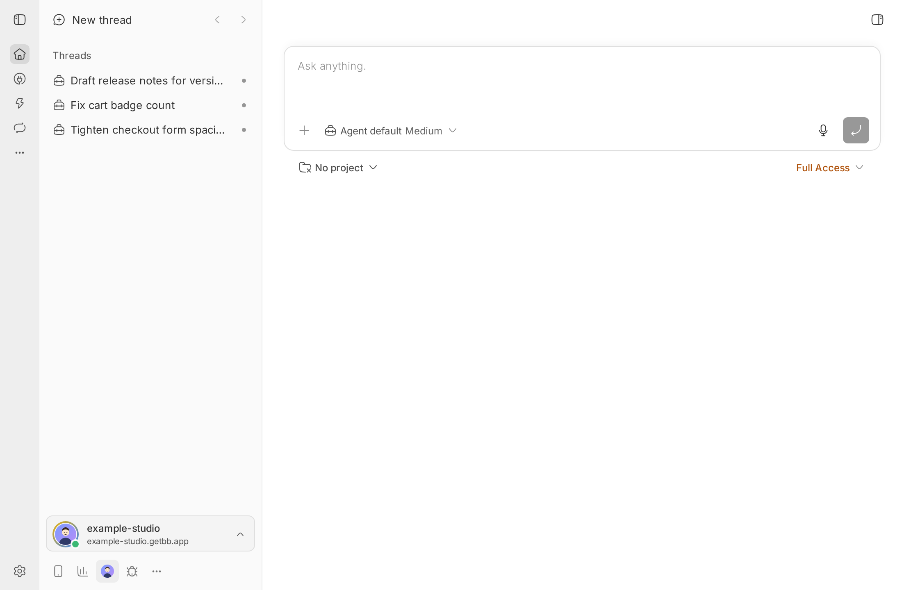
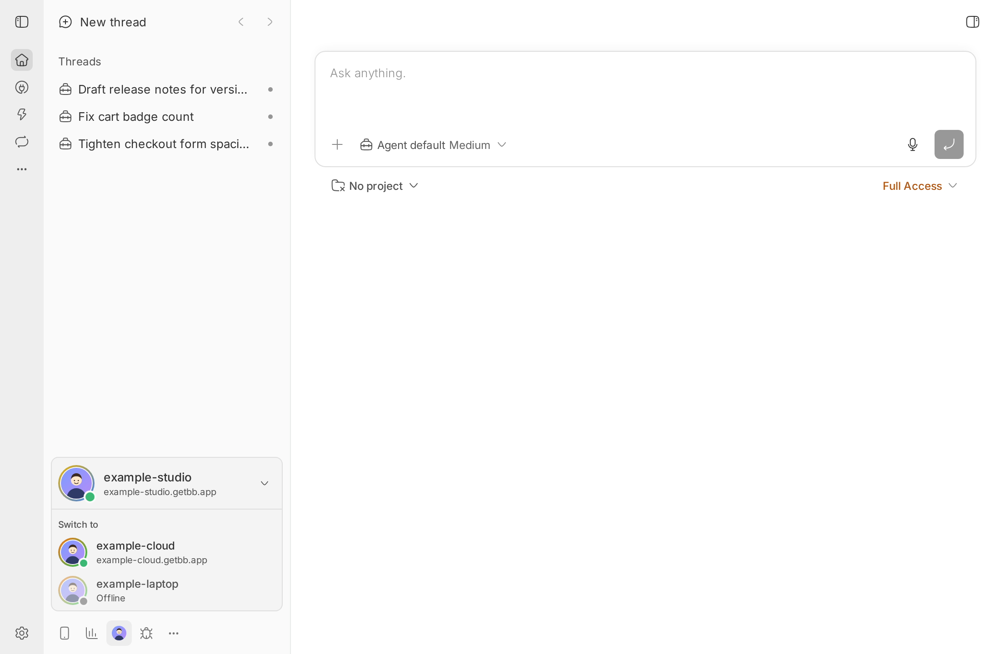
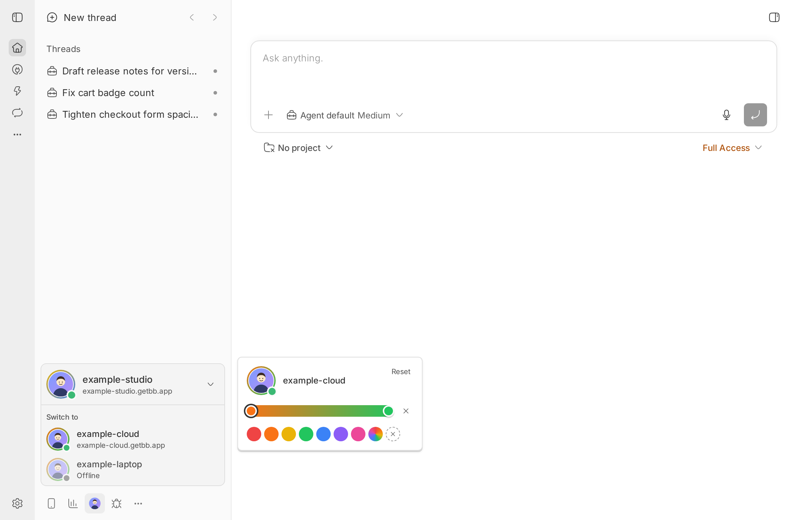

> [!NOTE]
> Maintained fork of brsbl/bb-plugins server-switcher0.1.2, snapshot00febc4b2585d2de6d837b05bd0b25dcefccef5c. Upstream package is UNLICENSED. Changes: on-demand footer and a native monochrome server icon; backend/account behavior preserved.

# Server Switcher

Shows the bb server you are on in a strip above the sidebar footer and switches
to any other server on your bb account with one click.







## Install

```bash
bb plugin install path:<bb-addons>/plugins/bb-plugin-server-switcher --yes
```

Requires a bb that is signed in to a bb account (`bb account login`) with the
bundled connect plugin enabled.

## Use

- The strip shows the current server's name, address, your GitHub avatar, and
  its colored ring. Click it to list the other servers on your account; offline
  servers are disabled.
  The panel is closed by default. Click the standard Servers icon in the footer
  to open or close it. Reloading after closing does not reopen it.
- In a browser or on a `*.getbb.app` URL, choosing a server opens it in the same
  tab. In the desktop app, the list follows the app's server menu and switches
  through it. In the bb mobile app the list is read-only.
- Click any server's avatar to change its ring: a preset or custom color, a
  two-color gradient (click the bar to add the second stop), no ring, or Reset
  to return to the server's default gradient.

```bash
bb server-switcher ring list
bb server-switcher ring set <server> <color> [<color>]
bb server-switcher ring clear <server>
bb server-switcher ring reset <server>
```

Rings are saved on the server you are viewing.

## Develop

From the monorepo root:

```bash
npm ci
npm run check --workspace=bb-plugin-server-switcher
bb plugin install "path:$PWD/plugins/server-switcher" --yes
```
